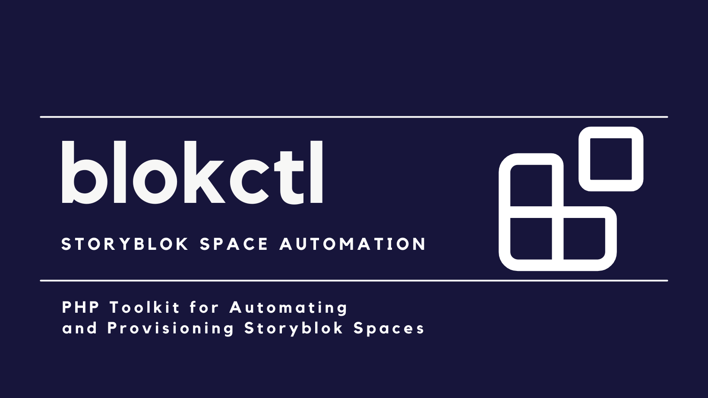

<p align="center">
    
</p>

<h1 align="center">blokctl</h1>

<p align="center">
    <a href="https://packagist.org/packages/hi-folks/blokctl"></a>
    <a href="https://packagist.org/packages/hi-folks/blokctl"></a>
    <br>
    
    
</p>

> **0.x — early testing phase:** `blokctl` is under active development. Commands and
> APIs may change. Use a test user, a scoped Personal Access Token, and non-production
> spaces while evaluating it.

**Explore, manage, and automate your Storyblok spaces from the command line.**

Storyblok's visual editor is where teams work with content. Its Management API also
makes it possible to inspect and administer spaces programmatically, but using that
API directly means handling endpoints, identifiers, pagination, and operation-specific
behavior yourself.

`blokctl` turns those operations into approachable CLI commands and reusable PHP
actions. Start by listing spaces or inspecting components. As your needs grow, use the
same toolkit for repeatable administration, scripts, and complete space setups defined
in version-controlled YAML or JSON.

`blokctl` is an unofficial open-source project and is not affiliated with Storyblok.

## Why blokctl?

### Explore and understand a space

You inherit a space, prepare an audit, or need to answer a question without clicking
through every settings screen. `blokctl` can list the spaces available to your account
and inspect their components, stories, assets, datasources, roles, workflows, apps,
languages, and preview environments.

The benefit is a quick, scriptable view of how a space is organized, beginning with
read-only commands that do not change content.

### Manage everyday administration

Some jobs are straightforward but repetitive: adding component fields, updating
preview URLs, managing datasource entries, assigning tags or workflow stages, and
maintaining collaborators and roles. `blokctl` provides focused commands for these
tasks, including confirmation or preflight behavior where the command implements it.

The benefit is less manual repetition and a visible command that can be reviewed,
documented, and run again.

### Automate recurring workflows

A one-off command often becomes a shell script, scheduled job, or application
workflow. CLI commands can run non-interactively, and the underlying PHP Action
classes can be called directly from PHP applications, queue workers, and tests.

The benefit is consistent automation without reimplementing the Management API
integration for every project.

### Build reproducible environments

Creating a demo or project space can involve components, datasources, content,
assets, languages, roles, workflows, apps, and preview URLs. `space:setup` expresses
that desired setup in YAML or JSON, validates it, shows a dry-run plan, and applies it
in reconcile mode.

The benefit is a reviewable setup that can be versioned, composed, audited, and
safely reapplied instead of relying on a checklist of manual steps.

## blokctl and the official Storyblok CLI

`blokctl` complements the official [Storyblok CLI](https://www.storyblok.com/docs/tooling/cli);
it is not intended to replace it. Both use Storyblok's Management API, but their
workflows emphasize different jobs.

| When you need to... | Official Storyblok CLI | blokctl |
|---|---|---|
| Scaffold a frontend project | Provides the `create` workflow | Not a project scaffolder |
| Move local resources in and out of spaces | Pulls and pushes assets, components, datasources, and stories | Provides focused create, update, list, export, and administrative commands |
| Work with code-defined schemas and content migrations | Provides schema, migration, validation, and type-generation workflows | Reconciles declared component fields and validates setup content through `space:setup` |
| Explore a space from the terminal | Finds stories and pulls resource definitions | Provides targeted list, show, usage, and comparison commands across administrative resources |
| Perform fine-grained administration | Supports its documented resource workflows | Focuses on preview URLs, collaborators, roles, workflows, apps, story lifecycle, datasources, and related operations |
| Automate from application code | Designed primarily as a CLI and CI tool | Exposes the CLI's business operations as reusable PHP Actions |
| Provision a multi-resource environment | Uses resource-oriented pull, push, and schema workflows | Applies one composable YAML/JSON setup across supported space resources |

Use the official CLI when its local synchronization, schema, migration, or project
workflows match the job. Use `blokctl` for its administrative commands, PHP API, or
declarative multi-resource setup. It is reasonable to use both in the same project.

## Getting started

### Requirements

- PHP 8.4.1 or higher.
- Composer.
- A Storyblok [Management API access token](https://www.storyblok.com/docs/concepts/access-tokens#management-api-access-tokens).
  Prefer a [scoped Personal Access Token](https://www.storyblok.com/cl/scoped-personal-access-tokens)
  with only the permissions and space access you need.

### Install as a standalone CLI

```bash
composer create-project hi-folks/blokctl
cd blokctl
```

Run the CLI from the project directory with `php bin/blokctl`.

### Install in an existing PHP project

```bash
composer require hi-folks/blokctl
```

Composer exposes the executable as `vendor/bin/blokctl`, and the package's PHP
Actions are available through Composer autoloading. The examples below use the
standalone `php bin/blokctl` form; replace it with `vendor/bin/blokctl` when installed
as a dependency.

### Configure authentication

Copy the provided environment example and add your scoped token:

```bash
cp .env.example .env
```

```env
SECRET_KEY=your-scoped-personal-access-token
```

The token's permissions determine which spaces and operations are available. The CLI
uses the EU region by default. For a space in another supported region, pass
`--region` (or `-R`) with `US`, `AP`, `CA`, or `CN`.

## Your first commands

Begin with read-only exploration.

### 1. List your spaces

```bash
php bin/blokctl spaces:list
```

This verifies authentication and shows the space IDs available to the token. You can
also narrow the list without changing anything:

```bash
php bin/blokctl spaces:list --search=demo
```

For a non-EU account, add the appropriate region:

```bash
php bin/blokctl spaces:list --region=US
```

### 2. Inspect one space

Replace `123456` with an exact space ID returned by `spaces:list`:

```bash
php bin/blokctl space:info --space-id=123456
```

The command shows the space's plan, ownership, demo status, current user, default
preview URL, and additional preview environments.

### 3. Explore its structure and content

```bash
php bin/blokctl components:list --space-id=123456
php bin/blokctl stories:list --space-id=123456 --per-page=10
php bin/blokctl datasources:list --space-id=123456
```

These commands are read-only. To inspect the available filters and exact options for
any command, use the built-in help:

```bash
php bin/blokctl help stories:list
php bin/blokctl list
```

## What can you do with blokctl?

The examples below are representative rather than an exhaustive command list. See the
[complete CLI and PHP Action reference](docs/command-reference.md) for every command
and option.

### Explore

- List and filter spaces with `spaces:list`, then inspect ownership, plan, and preview
  settings with `space:info`.
- Browse components and schemas with `components:list` and `component:show`.
- Find stories and inspect complete content with `stories:list` and `story:show`.
- Review assets, datasources, workflows, roles, collaborators, apps, and languages.
- Analyze component usage or compare component definitions between two spaces.

### Manage

- Create and update components, component folders, and fields.
- Create stories, move them, update fields, publish or unpublish them, assign tags,
  and change workflow stages.
- Reconcile datasource definitions, dimensions, and entries, including CSV workflows.
- Configure preview URLs, languages, custom roles, collaborators, workflows, and apps.
- Create folders and connect them to the Dimensions app.
- Find unreferenced assets and convert selected assets to the Global Asset Library.

Mutating commands have different safeguards because their underlying operations
differ. Check `help`, use a documented `--dry-run` where available, and test changes
against a non-production space first.

### Automate

- Use `--no-interaction` (`-n`) when a command has all required values and must run
  unattended.
- Compose CLI commands in shell scripts and CI jobs.
- Use typed PHP Action and Result classes from Laravel, Symfony, workers, or custom
  scripts.
- Adapt the practical workflows in [`examples/`](examples/), including bulk user
  access, market validation, reporting, and demo setup.

### Provision

- Create a blank space or duplicate an existing one.
- Export supported configuration from an existing space into setup YAML.
- Declare components, datasources, content, assets, languages, roles, workflows,
  apps, preview URLs, and other supported settings in one setup.
- Compose reusable setup files with `extends`, inputs, conditions, and assertions.
- Validate locally, preview operations with `--dry-run`, reconcile the target, and
  retain a machine-readable report.

## Automation and Configuration as Code

### Reuse the PHP Action API

Every domain operation is implemented as a framework-independent Action class. For
example, an application can list spaces without invoking a console command:

```php
use Blokctl\Action\Space\SpacesListAction;
use Storyblok\ManagementApi\ManagementApiClient;

$client = new ManagementApiClient(
    $_ENV['SECRET_KEY'],
    shouldRetry: true,
);

$result = (new SpacesListAction($client))->execute(search: 'demo');

foreach ($result->spaces as $space) {
    echo $space->name() . PHP_EOL;
}
```

Actions accept the Management API client and plain values, and return typed Result
objects. See [Using Actions from code](docs/command-reference.md#using-actions-from-code)
for setup and domain examples.

### Define a repeatable space setup

A minimal setup can create a blank space and configure its preview URL:

```yaml
version: 1

space:
  create_new: true
  name: New Storyblok Space

preview:
  default: "https://example.com/?token=${{ space.preview_token }}&path="
```

Validate a setup before it can change Storyblok:

```bash
php bin/blokctl space:setup-validate --config=setup.yaml
```

Then inspect the complete no-change execution plan:

```bash
php bin/blokctl space:setup --config=setup.yaml --dry-run --report=setup-plan.json
```

Review the configuration and plan before running the same command without
`--dry-run`. For an existing target, omit creation settings from the YAML and pass its
exact numeric ID with `--space-id`.

Start with the [space setup guide](space-setup-config.md), then see
[reusable configurations](space-setup-reusable-configs.md) and the runnable
[`examples/`](examples/). Local template catalog commands are available later in this
workflow when you maintain a library of reusable setups.

## Documentation

| Document | Use it for |
|---|---|
| [CLI and PHP Action reference](docs/command-reference.md) | Every command, option, and PHP Action example |
| [Space setup configuration](space-setup-config.md) | Complete `space:setup` YAML/JSON format and behavior |
| [Reusable space setups](space-setup-reusable-configs.md) | Composition with `extends`, inputs, conditions, and assertions |
| [Examples](examples/) | Runnable configurations and automation scripts |
| [Management API behavior](management-api-behavior.md) | API behavior verified while building `blokctl` |
| [AI-assisted setup workflow](docs/ai-space-setup-workflow.md) | Guarded AI authoring, validation, dry-run, and approval workflow |
| [Changelog](CHANGELOG.md) | Changes by release |
| [Contributing](CONTRIBUTING.md) | How to propose and prepare changes |

The CLI is also self-documenting:

```bash
php bin/blokctl list
php bin/blokctl help space:setup
```

## Safety and limitations

- `blokctl` is currently a 0.x project. Review the changelog when upgrading because
  command and API compatibility is not yet guaranteed.
- Use a scoped Personal Access Token with the minimum required permissions. Do not
  commit `.env` or tokens.
- Begin with a test user and non-production spaces. Some commands create, update,
  publish, unpublish, or delete data.
- A few mutating commands provide `--dry-run`, preflight checks, or confirmation;
  these protections are command-specific. Do not assume every operation supports
  dry-run or rollback.
- `space:setup` validates the complete configuration before mutation, supports a
  dry-run plan, and reconciles only declared state. It does not provide a general
  rollback, and a failed multi-step setup can leave successfully completed operations
  in place. Keep its JSON report for diagnosis and safe reruns.
- Storyblok plan features and token permissions still apply. An operation can be
  implemented by `blokctl` but unavailable to a particular account or space.

Known API behavior and limitations are documented in
[`management-api-behavior.md`](management-api-behavior.md).

## Contributing

Issues and contributions are welcome. Read [CONTRIBUTING.md](CONTRIBUTING.md) before
opening a pull request, and use [GitHub Issues](https://github.com/hi-folks/blokctl/issues)
for bug reports and feature requests.

## License

MIT
