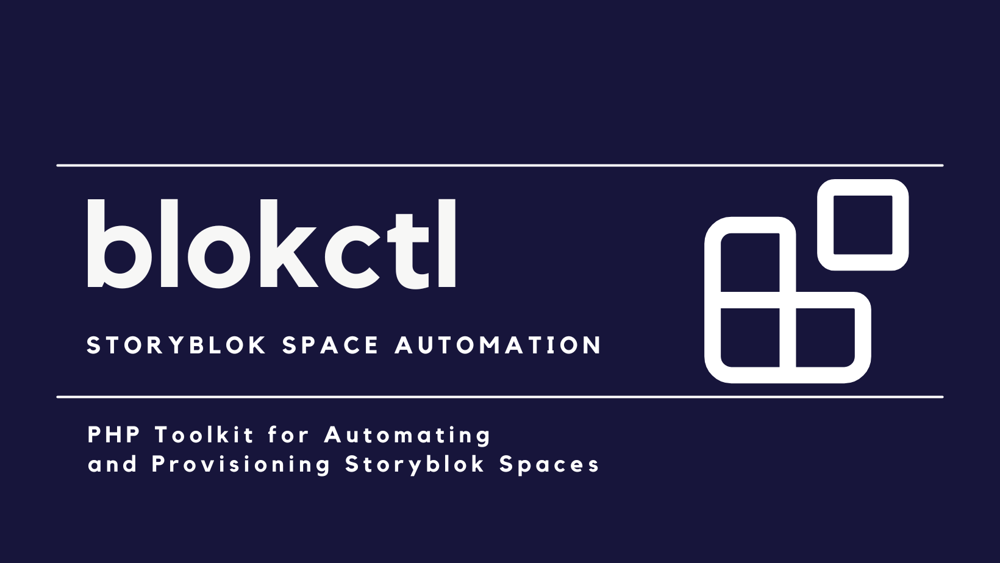

# blokctl CLI and PHP Action Reference

This document preserves the detailed CLI command and PHP Action API documentation.
For the project overview and first-use guide, start with the
[main README](../README.md).

<p align="center">
    
</p>

<h1 align="center">
    blokctl
</h1>

<p align=center>
    <a href="https://packagist.org/packages/hi-folks/blokctl">
        
    </a>
    <a href="https://packagist.org/packages/hi-folks/blokctl">
        
    </a>
    <br>
    
    <br>
    
    
</p>


<p align=center>
    <i>
        An unofficial Storyblok automation toolkit providing a command-line interface, reusable PHP API, and Configuration as Code provisioning.
    </i>
</p>


> **0.x — Early testing phase**
>
> This package is currently at version **0.x**, which means it is under active development and testing. APIs and commands may change without notice.
>
> If you'd like to participate in testing, feel free to use it and share your feedback, bug reports, and feature requests via [GitHub Issues](https://github.com/hi-folks/blokctl/issues).
>
> **Important:** Since this is a testing phase, use a **test user** with a **scoped Personal Access Token** that only has the required Management API permissions and access to a **test space**. Do not use production credentials or spaces.

**An unofficial Storyblok automation toolkit.**

`blokctl` provides a command-line interface, reusable PHP API, and Configuration as Code provisioning for managing and automating [Storyblok](https://www.storyblok.com/) spaces.

Use individual commands or PHP actions to automate specific operations, or define repeatable space setups in version-controlled YAML or JSON configuration files. Configure spaces, shape components, manage stories, set preview URLs, install apps, assign workflows and tags, and provision complete demo environments.

## How is `blokctl` different from the official Storyblok CLI?

The official [Storyblok CLI](https://www.storyblok.com/docs/tooling/cli) scaffolds Storyblok projects and provides Management API workflows for resources such as assets, components, datasources, stories, schemas, and migrations.

**blokctl** is a different kind of tool. It focuses on **crafting and auto-setup**: fine-tuning and adapting your Storyblok space programmatically. Use it to configure preview URLs, install apps, assign workflow stages, manage tags, add component fields, and orchestrate demo setups — all from the command line or from your own PHP code.

## Documentation

| Document | Use it for |
|---|---|
| This reference | Every CLI command and the PHP Action API |
| [space-setup-config.md](../space-setup-config.md) | Reference for `space:setup` configuration files: every section and key, merge rules for `extends`, `when`, `assert`, removals |
| [space-setup-reusable-configs.md](../space-setup-reusable-configs.md) | Guide: export a showcase space into reusable files, write short customer files, make parts optional, check the target space, apply |
| [AI-assisted setup workflow](ai-space-setup-workflow.md) | Guarded workflow for AI assistants: inspect read-only, generate YAML, validate, dry-run, request approval, apply |
| [examples/](../examples/) | Ready-to-run setup configs (composition, components, datasources, governance, roles, assets, multi-country) and scripts |
| [management-api-behavior.md](../management-api-behavior.md) | Management API behavior verified with live requests, for your own automation |
| [CHANGELOG.md](../CHANGELOG.md) | Changes per release |

## Requirements

- PHP 8.4.1 or higher
- A Storyblok [Management API access token](https://www.storyblok.com/docs/concepts/access-tokens#management-api-access-tokens). Prefer a [scoped Personal Access Token](https://www.storyblok.com/cl/scoped-personal-access-tokens) with only the permissions you need.

## Installation

To install the `blokctl` as a project you can run:

```bash
composer create-project hi-folks/blokctl
# enter into the new directory created
cd blokctl
```

If you want to use the `blokctl` functions and functionalities in your PHP project (Laravel or Symfony also) you can install it as package:
```bash
composer require hi-folks/blokctl
```


## Setup

Create a `.env` file in your project root:

```env
SECRET_KEY=your-scoped-personal-access-token
```

You can copy the provided example:

```bash
cp .env.example .env
```

## Usage

```bash
php bin/blokctl <command> [options] [arguments]
```

List all available commands:

```bash
php bin/blokctl list
```

### Global options

Most commands accept the following option:

| Option | Short | Description |
|---|---|---|
| `--space-id` | `-S` | The Storyblok Space ID |
| `--region` | `-R` | The Storyblok region (`EU`, `US`, `AP`, `CA`, `CN`). Defaults to `EU` |
| `--no-interaction` | `-n` | Run without interactive prompts (requires all options to be provided) |

If `--space-id` is omitted, the command will prompt for it interactively.

By default, commands connect to the **EU** region. Use `--region` (`-R`) to target a different Storyblok region:

```bash
# US region
php bin/blokctl space:info -S 290817118944379 -R US

# Asia-Pacific region
php bin/blokctl spaces:list -R AP

# Canada region
php bin/blokctl spaces:list -R CA
```

Available regions: `EU` (default), `US`, `AP`, `CA`, `CN`.

---

## Commands

### Setup templates

Template catalog commands discover ordinary `space:setup` YAML or JSON files that
declare top-level [`template` metadata](../space-setup-config.md#template-metadata). They
are local and read-only: no Storyblok token or space ID is required. The directory
defaults to the current directory and is scanned only at its top level unless `-r` is
provided. Supported extensions are `.yaml`, `.yml`, and `.json`.

#### `template:list` — List setup templates

```bash
# Current directory
php bin/blokctl template:list

# A template library and all its subdirectories
php bin/blokctl template:list templates/ --recursive

# Machine-readable catalog
php bin/blokctl template:list templates/ -r --json
```

Each template is shown as a bullet with its category, owner, tags, and file on indented
lines. Config files
without `template` metadata are ignored. Invalid candidates are listed separately and
do not prevent valid templates from being returned.

| Option | Short | Description |
|---|---|---|
| `--recursive` | `-r` | Scan subdirectories, excluding dependency, cache, and VCS directories |
| `--json` | | Emit `{templates, errors}` for scripts and AI assistants |

#### `template:show` — Show one setup template

```bash
php bin/blokctl template:show templates/retail-demo.yaml
php bin/blokctl template:show templates/retail-demo.yaml --json
```

The file is loaded through the same `extends` merger and JSON Schema validator as
`space:setup`. Output includes merged metadata, declared input names, target mode
(`existing`, `create`, or `duplicate`), direct `extends` files, path, and validation
status. An invalid config or a config without `template` metadata exits with status 1.

#### `template:find` — Find templates by metadata

```bash
php bin/blokctl template:find templates/ --tag=multilingual
php bin/blokctl template:find templates/ -r \
  --tag=retail --tag=multilingual \
  --category=commerce
php bin/blokctl template:find templates/ --search=shopify --json
```

`--tag` is repeatable and every requested tag must be present. Category and owner use
case-insensitive exact matching. `--search` performs case-insensitive text matching
across name, description, category, owner, tags, and path. Different filters are
combined with AND. With no filters, `template:find` returns the same templates as
`template:list`.

| Option | Description |
|---|---|
| `--tag` | Required tag; repeat to require multiple tags |
| `--category` | Exact metadata category |
| `--owner` | Exact metadata owner |
| `--search` | Text search across template metadata and path |
| `--recursive`, `-r` | Scan subdirectories |
| `--json` | Emit matching templates and skipped-file errors as JSON |

### Spaces

#### `spaces:list` — List all spaces

```bash
php bin/blokctl spaces:list
php bin/blokctl spaces:list --search=demo
php bin/blokctl spaces:list --owned-only
php bin/blokctl spaces:list --updated-before=90
php bin/blokctl spaces:list --owned-only --updated-before=90 --solo-only
```

| Option | Description |
|---|---|
| `--search` | Filter spaces by name |
| `--owned-only` | Only show spaces owned by the authenticated user |
| `--updated-before` | Only show spaces last updated more than N days ago (e.g. `90`) |
| `--solo-only` | Only show spaces where the user is the only collaborator (implies `--owned-only`) |

Filters are applied in order: `--owned-only` and `--updated-before` first (no extra API calls), then `--solo-only` (one API call per remaining space to check collaborators). Combining all three minimizes API calls.

Each space displays: name, ID, plan, demo mode flag, created date, and last updated date.

> This command does not require `--space-id`.

#### `space:create` — Create or duplicate a space

```bash
# Create a blank space
php bin/blokctl space:create 'My New Demo Space'
php bin/blokctl space:create --name='My New Demo Space'

# Duplicate an existing space into the current organization
php bin/blokctl space:create 'NEW SPACE FROM TEMPLATE' \
  --duplicate-from=286863409930127 \
  --in-org \
  --demo

# Scripting: output only the new space ID
php bin/blokctl space:create 'NEW SPACE FROM TEMPLATE' \
  --duplicate-from=286863409930127 \
  --in-org \
  --demo \
  --only-id \
  -n
```

Creates a new Storyblok space. When `--duplicate-from` is provided, the command duplicates the source space ID using the Management API payload supported by Storyblok (`dup_id`, `in_org`, and `space.is_demo`).

| Type | Name | Description |
|---|---|---|
| Argument | `name` | New space name (prompted interactively if omitted) |
| Option | `--name` | New space name, useful when you prefer option-style commands |
| Option | `--duplicate-from` | Existing space ID to duplicate |
| Option | `--in-org` | Create the duplicated space inside the current organization |
| Option | `--demo` | Mark the created space as a demo/example space |
| Option | `--only-id` | Output only the new space ID, useful for scripts |

> This command does not require `--space-id`.

#### `space:setup` — Set up a space from a config file

`space:setup` follows a **Configuration as Code** approach: the desired Storyblok configuration is stored in version-controlled YAML or JSON, making demo-space provisioning reproducible and automatable.

```bash
# Apply a config without a space section to an existing space
php bin/blokctl space:setup -S 290817118944379 --config existing-space.yaml

# Duplicate a template space, then apply the setup to the newly created space
php bin/blokctl space:setup --config examples/demo-space.yaml

# Preview the plan without changing Storyblok
php bin/blokctl space:setup -S 290817118944379 --config existing-space.yaml --dry-run

# Preview duplication and the complete setup plan without creating a space
php bin/blokctl space:setup --config examples/demo-space.yaml --dry-run

# Override setup inputs
php bin/blokctl space:setup \
  --config examples/demo-space.yaml \
  --set frontend_host=customer-demo.example.com

# Validate locally against the JSON Schema and declared components
php bin/blokctl space:setup-validate --config examples/demo-space.yaml
```

Secrets should be declared as inputs and sourced from the environment:

```yaml
inputs:
  integration_api_key:
    required: true
    secret: true
    from_env: CUSTOMER_INTEGRATION_API_KEY
```

Use `${{ inputs.integration_api_key }}` in the config. blokctl masks the resolved value
as `********` in validation and merged output, dry-run and real-run console output, and
JSON setup reports. Prefer `from_env` over `--set` for secrets because command-line
values may remain in shell history or appear in the process list. Direct
`${{ env.NAME }}` expressions cannot be identified as secret automatically. See
[Secret inputs](../space-setup-config.md#secret-inputs) for precedence, guarantees, and
security boundaries.

The setup config supports JSON and YAML and is validated against [space-setup-schema.json](../space-setup-schema.json) before any space is created or modified. See [examples/demo-space.yaml](../examples/demo-space.yaml) for general provisioning, [examples/multi-country-space.yaml](../examples/multi-country-space.yaml) for folder, root-content move, and Dimensions reconciliation, [examples/assets-space.yaml](../examples/assets-space.yaml) for local-directory asset upload, [examples/roles-space.yaml](../examples/roles-space.yaml) for custom space roles, [examples/datasources-space.yaml](../examples/datasources-space.yaml) for datasources with dimensions and CSV entries, [examples/components-space.yaml](../examples/components-space.yaml) for a new component that uses a datasource and is added to the home page, and [examples/governance-space.yaml](../examples/governance-space.yaml) for roles plus a custom review workflow. See [space-setup-config.md](../space-setup-config.md) for the full configuration syntax, and [space-setup-reusable-configs.md](../space-setup-reusable-configs.md) for building reusable setups from small files.

Reusable configs can declare optional `template` metadata (`name`, `description`,
`category`, `owner`, and `tags`). It identifies and describes the config without
changing the Storyblok space, survives `extends` merging, and is included in JSON setup
reports. See [Template Metadata](../space-setup-config.md#template-metadata).

When the config creates, inserts, or updates story content, `space:setup` also performs a content-schema preflight before creating, duplicating, or modifying a space. For an existing target it reads that space's components; for duplication it reads the source space; for a new blank space it uses the components declared in the config. A content error stops the run before any mutation.

```yaml
template:
  name: Customer Demo
  category: general
  owner: solutions-engineering
  tags: [customer-demo, multilingual]

execution:
  mode: reconcile

space:
  name: "Customer Demo"
  duplicate_from: "286863409930127"
  in_org: true
  demo: false
  languages:
    - it
  readiness:
    timeout_seconds: 120
```

Reconcile mode is the default. Repeated setup runs preserve unmanaged resources, skip matching state, merge story tags and preview environments, and update only explicitly configured component field properties. Resources omitted from the config are never removed automatically.

**Reusable config files.** For a step-by-step guide (export a showcase space into a library, write short customer files, add optional parts and checks), see [Reusable space setups](../space-setup-reusable-configs.md).

A config can extend other config files with `extends`, so common parts (components, datasources, roles, workflows) live in their own files and each customer file adds only what is specific. Named items such as components, fields, datasources, entries, roles, and stages merge by name or slug; check the result with `space:setup-validate --print-merged`. An `extends` entry can be optional (`{path, when}`), so one file covers variants, for example `when: ${{ inputs.with_governance }}` switched with `--set with_governance=false`. See [examples/composition/](../examples/composition/) and the merge rules in [space-setup-config.md](../space-setup-config.md).

```yaml
version: 1
extends:
  - base/components.yaml
  - base/datasources.yaml
components:
  ensure:
    - name: promo-banner   # merged with the base definition
      color: "#003366"
```

**Template checks.** An `assert` section checks the target space before any change, for example that a duplicated template has the `home` story and the `hero-section` component, or that the plan is at least Elite. If something is missing, the setup stops and lists everything missing in one message. Items the config creates itself count as present. See [`assert`](../space-setup-config.md#assert).

**Removals run last.** Something is removed only when the config asks for it explicitly, for example `space.languages.remove`, `stories.unpublish`, or `datasources[].remove_entries`. All removals run at the end of the setup, after every create and update. This order lets the same run move content away from what is being removed (for example, create a new stage and assign stories to it before an old one is removed), and if a step fails earlier, the run stops before anything is deleted. With `--continue-on-error` (or `execution.continue_on_error: true`) the run continues after a failure and still reaches the removals, so avoid it for configs that remove resources.

When a removal must happen **first**, for example because a new resource needs a name, color, or content type that the removed resource still uses, split the work into two runs:

```bash
# 1. A config that contains only the removal
php bin/blokctl space:setup -S 290817118944379 --config cleanup.yaml

# 2. The main config, which can now create the replacement
php bin/blokctl space:setup -S 290817118944379 --config space.yaml
```

Running the removal on its own also makes it easier to review with `--dry-run` before applying it.

Languages declared under `space.languages` are ensured before story operations run. This is useful for translated slugs and field-level translations that require the language to exist in Storyblok Settings -> Internationalization. The shorthand list adds missing language codes and preserves existing unmanaged languages; use `space.languages.add`, `space.languages.ensure`, and `space.languages.remove` in the full setup syntax when removals are required. Additions run before story operations; removals run at the end of the setup.

Story content can be personalized per demo: `stories.update` changes fields of existing components by path, `stories.insert_component` adds a component to a list field such as `content.body` (a rerun does not insert it twice), and `stories.publish` publishes the result in the same run.

Local asset directories can also be reconciled into Storyblok asset folders. Paths are relative to the setup config file, nested directories can be preserved, and assets with the same filename in the same target folder are skipped.

Assets can also be uploaded from URLs with `assets.upload_url` and used by name in story content with `asset: { _ref: customer_logo }`, for example a customer logo whose URL is passed with `--set logo_url=...`. An asset with the same filename in the target folder is reused. See [`assets.upload_url`](../space-setup-config.md#assetsupload_url).

Space-local assets can also be converted into the organization Global Asset Library through `assets.convert_to_global`. Each entry requires `target_shared_folder_id` and exactly one source selector: `asset_id`, `asset_ids`, `source_folder_id`, or `source_folder_name`.

```yaml
assets:
  convert_to_global:
    - asset_ids: [123, 456]
      target_shared_folder_id: 987

    - source_folder_name: Brand
      target_shared_folder_id: 987
      filters:
        filetype: image
        extensions: [jpg, png, webp]
        tags: [approved]
```

Stories can be created or updated declaratively. Component updates use a deterministic content path and an expected component name, so setup fails instead of changing the wrong block when the template structure changes.

```yaml
stories:
  create:
    - name: Auto Created
      slug: auto-created
      content:
        component: default-page
        body:
          - component: hero-section
            eyebrow: "Provisioned by blokctl"
            text: "This story was automatically created by the provisioning system."
            image:
              asset:
                _find:
                  search: "joyful-banner.png"
                  in_folder: Provisioned
                  require_unique: true
                alt: "Automatically provisioned demo hero image"
            headline:
              - component: headline-segment
                text: "Automatically created by the provisioning system"

  update:
    - slug: home
      components:
        - path: content.body[0].headline[0]
          component: headline-segment
          fields:
            text: "${{ inputs.space_name }}"
```

Asset fields can use `asset._find` to resolve an existing uploaded asset by Management API filters such as `search`, `in_folder`, `by_alt`, `by_title`, `by_copyright`, and `tags`. By default `require_unique` is true, so setup fails if no asset or multiple assets match.

Workflow stages can be assigned globally to unstaged stories, or explicitly to selected story slugs or IDs:

```yaml
workflow:
  assign_unstaged: true
  stage_id: null
  assign:
    - stories:
        slugs: [home, about]
      workflow: Default
      stage: Drafting
```

Storyblok AI can be activated independently from installing AI-related apps by declaring `ai.enabled` and `ai.inherit_org_configuration`. AI Translations disclaimer acceptance is configured separately with `ai_translation.disclaimer_id`.

After duplicating a space, setup waits until Storyblok reports that the new space has no pending background tasks. The readiness timeout defaults to 120 seconds and can be configured under `space.readiness`. Blank-space creation, existing-space setup, and dry runs do not perform readiness polling.

To create and configure a blank space instead of duplicating a template:

```yaml
space:
  create_new: true
  name: "Customer Demo"
```

| Option | Description |
|---|---|
| `--space-id`, `-S` | Existing Storyblok Space ID to set up |
| `--config`, `-c` | JSON or YAML setup configuration file |
| `--dry-run` | Print the planned setup without changing Storyblok |
| `--continue-on-error` | Continue after a non-fatal step failure |
| `--report` | Write a machine-readable JSON setup report |
| `--set` | Override a declared setup input as `NAME=VALUE` (repeatable; prefer `from_env` for secrets) |

Choose exactly one target mode: use `-S` to reconcile an existing space, configure `space.create_new: true` with `space.name` to create a blank target, or configure `space.duplicate_from` with `space.name` to duplicate a template. Other setup sections work identically with every target mode.

With `--dry-run` and a configured `space.create_new` or `space.duplicate_from`, no space is created. The complete desired setup plan is rendered using `NEW_SPACE_ID` and `PREVIEW_TOKEN` placeholders. Dry-run does not inspect the current target state, so real execution may report matching operations as `SKIPPED`.

Both dry-run and real execution use compact operation statuses such as `PLANNED`, `UPDATED`, `INSTALLED`, `CREATED`, `REMOVED`, `SKIPPED`, and `FAILED`, followed by a final summary. Preview tokens are masked in rendered URLs.

When `--continue-on-error`, `continue_on_error`, or app-specific continuation is enabled, setup continues after failed operations but still exits with a non-zero status so scripts and CI jobs can detect the incomplete setup.

Use `--report` to write the target space, duplication readiness details, individual operation results, and summary counts as JSON:

```bash
php bin/blokctl space:setup --config examples/demo-space.yaml --report setup-result.json
```

Reports are also written for dry runs and partial setup failures. Preview tokens and
values from inputs declared with `secret: true` are masked.

When duplicate-first provisioning fails after the new space is created, blokctl preserves the duplicated space for inspection or recovery. It does not automatically delete or roll back the space. Use `--report` to retain its space ID and the completed, skipped, and failed operation details.

#### `space:setup-validate` — Validate a setup config

`space:setup-validate` checks a YAML or JSON setup without changing Storyblok. Local validation does not require a token or space ID. It validates the merged configuration against [space-setup-schema.json](../space-setup-schema.json), then checks story content against fields declared in `components.ensure` and `components.fields`.

```bash
# Local validation with human-readable output
php bin/blokctl space:setup-validate --config setup.yaml

# Stable output for scripts and AI repair loops
php bin/blokctl space:setup-validate --config setup.yaml --json

# Read existing component definitions from a space (read-only)
php bin/blokctl space:setup-validate \
  -S 290817118944379 \
  --config setup.yaml \
  --json

# Validate a composed variant and include its merged config in the JSON response
php bin/blokctl space:setup-validate \
  --config customers/acme.yaml \
  --set with_governance=false \
  --print-merged \
  --json
```

Passing `-S` is optional and read-only: the command fetches components but never writes to the space. It therefore requires a valid Management API token and access to that exact space. Use `-R` when the space is outside the default EU region. Without `-S`, a component used by story content but not declared in the config is returned as a warning because its fields cannot be checked locally.

Content validation covers:

- root components and fields in `stories.create`, including JSON `content_file` paths resolved relative to the setup file;
- components inserted with `stories.insert_component` and partial fields changed by `stories.update`;
- unknown fields and components, with a suggestion for close field-name misspellings;
- required fields for created and inserted content (not for partial updates);
- basic Storyblok value shapes and types, including text, numbers, booleans, options, assets, links, rich text, multi-assets, and block lists;
- recursively nested `bloks` and `component_whitelist` restrictions.

Runtime expressions and directives such as `${{ inputs.title }}`, `_asset`, `_slug`, `asset._find`, and `asset._ref` are resolved later and are intentionally not type-checked as literal values.

Successful `--json` output has a stable top-level shape:

```json
{
  "valid": true,
  "errors": [],
  "warnings": []
}
```

Invalid schema or story content exits with status `1` and lists paths that an automation or AI assistant can repair:

```json
{
  "valid": false,
  "errors": [
    "$.stories.create[0].content.headline: unknown field \"headline\" in component \"page\"."
  ],
  "warnings": []
}
```

An unchecked component is a warning and does not make an otherwise valid config fail:

```json
{
  "valid": true,
  "errors": [],
  "warnings": [
    "Component \"page\" was not checked; declare it in the config or pass --space-id."
  ]
}
```

With `--print-merged --json`, the response also contains a `config` property holding the fully merged configuration. Without `--json`, `--print-merged` prints that configuration as YAML. A valid result exits with status `0`.

| Option | Description |
|---|---|
| `--config`, `-c` | YAML or JSON setup file to validate |
| `--set` | Input value as `NAME=VALUE`, used by conditional `extends` entries; repeatable |
| `--print-merged` | Include or print the configuration after resolving `extends` |
| `--json` | Emit `{valid, errors, warnings}` instead of formatted console messages |
| `--space-id`, `-S` | Read existing component definitions from this exact space; no mutations |
| `--region`, `-R` | Region for `-S`: `EU`, `US`, `AP`, `CA`, or `CN`; defaults to `EU` |

For AI-assisted setup authoring, follow the complete guarded sequence in [Authoring Storyblok space setups with an AI assistant](ai-space-setup-workflow.md): inspect read-only, generate YAML, validate and repair, show a dry-run plan, and apply only after explicit approval.

#### `space:setup-export` — Export a space as a setup config

`space:setup-export` is the reverse of `space:setup`: it reads an existing space and writes its configuration in the `space:setup` format. Use it to capture a demo space you built in the UI as a versioned config, then apply it to another space.

```bash
# Export everything to a file, with datasource entries as CSV files next to it
php bin/blokctl space:setup-export -S 290817118944379 -o space.yaml --entries-dir=datasources

# Export only some components and datasources, and print the YAML
php bin/blokctl space:setup-export -S 290817118944379 --section=components --section=datasources \
  -c promo-banner -c hero-section -d banner-themes

# Apply the export to another space
php bin/blokctl space:setup -S 288868932106293 --config space.yaml --dry-run
```

| Option | Short | Description |
|---|---|---|
| `--section` | | `components`, `datasources`, `roles`, or `workflows` (repeatable). All sections when omitted |
| `--component` | `-c` | Component name to export (repeatable). All components when omitted |
| `--datasource` | `-d` | Datasource slug to export (repeatable). All datasources when omitted |
| `--output` | `-o` | YAML file to write. Prints the YAML when omitted |
| `--entries-dir` | | Write datasource entries as CSV files in this directory, relative to `--output`, and reference them with `entries_file` |
| `--secret-name` | | Name treated as a secret (repeatable). Replaces the default list |
| `--secret-placeholder` | | Text written instead of a secret value. Default `####YOURSECRET####` |
| `--include-secrets` | | Export secret values as they are (only for files that stay private) |

What is exported:

- **Components** (`components.ensure`): type, folder path, display name, color, icon, preview field, and every field in schema order with its tab. Field properties without a dedicated setup key (for example `maximum`, `use_uuid`, `conditional_settings`) are exported under `properties` and applied as-is.
- **Datasources** (`datasources`): name, dimensions, and entries with their dimension values.
- **Roles** (`roles`): permissions, allowed languages, and allowed and blocked paths as story full slugs.
- **Workflows** (`workflow.ensure`): content types and stages, with roles, next stages, and the after-publish stage by name.

IDs are replaced with names, slugs, and folder paths, so the config works in another space. Settings the setup format cannot express, such as role field permissions or workflow users, are listed as `# WARNING` comments at the top of the file and in the command output. The command validates its output and exits with a non-zero code if the export does not validate.

**Secrets are hidden by default.** Field plugins often keep a token in their options (for example `storyblokToken`), and a datasource can hold an `accessToken` entry. The export never writes these values. It writes a placeholder instead:

```yaml
options:
  - name: storyblokToken
    value: '####YOURSECRET####'
```

Each replaced value is listed as a warning, so you know what to fill in before applying the config to another space. Applying the file as it is writes the placeholder text into the field.

A value is treated as a secret when its name (option name, property name, or datasource entry name) **contains** one of these names, ignoring case, `_`, and `-`:

`token`, `access_token`, `secret`, `client_secret`, `password`, `passwd`, `api_key`, `private_key`, `access_key`, `credential`

So `access_token` also matches `accessToken` and `storyblokAccessToken`. Change the list or the placeholder for one run with `--secret-name` (repeatable) and `--secret-placeholder`, or for every run in `.env`:

```bash
BLOKCTL_SECRET_NAMES=token,secret,password,api_key
BLOKCTL_SECRET_PLACEHOLDER=####YOURSECRET####
```

Command-line options take priority over `.env`, and `.env` over the defaults. Use `--include-secrets` only for files that stay private.

The command shows its progress (one line per section, datasource, and workflow) on stderr, so printed YAML can be redirected to a file without progress lines in it. Use `-q` to hide progress and the summary.

Applying an export to the space it came from changes nothing: every operation is skipped.

#### `space:info` — Display space information

```bash
php bin/blokctl space:info -S 290817118944379
```

Shows space details (ID, name, plan, demo mode status), current user info, and preview URL configuration.

#### `space:delete` — Delete a space

```bash
php bin/blokctl space:delete -S 290817118944379
```

Permanently deletes a Storyblok space. One safety check is enforced before deletion:

1. The authenticated user must be the **owner** of the space

Before asking for confirmation, the command prints the space recap, activity signals exposed by the Management API (`created_at`, `updated_at`, pending tasks), useful metadata, owner, and collaborators. When other collaborators exist, it warns that deleting the space removes it for everyone. Prompts for confirmation before deleting. Use `-n` to skip the confirmation prompt.

#### `space:demo-remove` — Remove demo mode from a space

```bash
php bin/blokctl space:demo-remove -S 290817118944379
```

Prompts for confirmation before removing demo mode. Use `-n` to skip the confirmation prompt.

#### `space:language-list` — List enabled language codes

```bash
php bin/blokctl space:language-list -S 290817118944379
```

Reads the target space and prints the configured language codes.

| Type | Name | Short | Description |
|---|---|---|---|
| Option | `--space-id` | `-S` | **(required)** Storyblok Space ID |
| Option | `--region` | `-R` | Management API region |

#### `space:language-add` — Add language codes

```bash
php bin/blokctl space:language-add -S 290817118944379 it de fr
```

Reads the target space, preserves existing language codes, and updates the space with any missing codes. Each shorthand code is sent as a language object with a derived display name and AI translation code, then the action reads the space back and fails if Storyblok did not persist the requested code.

| Type | Name | Short | Description |
|---|---|---|---|
| Argument | `languages` | | **(required)** One or more language codes, e.g. `it de fr` |
| Option | `--space-id` | `-S` | **(required)** Storyblok Space ID |
| Option | `--region` | `-R` | Management API region |

#### `space:language-ensure` — Ensure language codes are enabled

```bash
php bin/blokctl space:language-ensure -S 290817118944379 it de fr
```

Alias-style idempotent add command. It uses the same action as `space:language-add`, preserving existing language codes, adding only missing codes, and verifying persistence with a read-back.

| Type | Name | Short | Description |
|---|---|---|---|
| Argument | `languages` | | **(required)** One or more language codes, e.g. `it de fr` |
| Option | `--space-id` | `-S` | **(required)** Storyblok Space ID |
| Option | `--region` | `-R` | Management API region |

#### `space:language-remove` — Remove language codes

```bash
php bin/blokctl space:language-remove -S 290817118944379 fr
```

Reads the target space, removes the requested language codes when present, preserves every other language code, and verifies with a read-back that Storyblok persisted the removal.

| Type | Name | Short | Description |
|---|---|---|---|
| Argument | `languages` | | **(required)** One or more language codes to remove, e.g. `fr it` |
| Option | `--space-id` | `-S` | **(required)** Storyblok Space ID |
| Option | `--region` | `-R` | Management API region |

#### `space:role-list` — List custom space roles

```bash
php bin/blokctl space:role-list -S 290817118944379
php bin/blokctl space:role-list -S 290817118944379 --search=Editors
```

| Option | Description |
|---|---|
| `--search` | Filter roles by name |

Shows each role with its ID, subtitle, permissions, allowed and blocked paths (as `slug (ID)`), and allowed languages. An empty list is shown as `all` (or `none` for blocked paths).

#### `space:role-ensure` — Create or update a custom space role

```bash
# Create a role that can only see and edit one folder
php bin/blokctl space:role-ensure -S 290817118944379 \
  --name="Editors - North" \
  --subtitle="Can edit the North region content only." \
  -p read_stories -p save_stories -p view_content -p view_folders -p view_composer \
  --allow=regions/north

# A role limited to one language
php bin/blokctl space:role-ensure -S 290817118944379 \
  --name="Translators - German" -p read_stories -p save_stories -l de
```

| Option | Short | Description |
|---|---|---|
| `--name` | | **(required)** Role name. The role is matched by exact name (prompted if omitted) |
| `--subtitle` | | Role description |
| `--permission` | `-p` | Permission key, e.g. `read_stories`, `save_stories`, `publish_stories`, `view_content`, `view_folders` (repeatable) |
| `--allow` | | Story or folder the role can access, by full slug or ID (repeatable). Elite plan only |
| `--block` | | Story or folder the role cannot access, by full slug or ID (repeatable) |
| `--language` | `-l` | Language code the role can edit, e.g. `default`, `de` (repeatable) |

Creates the role when no role with that name exists. Otherwise it updates only the options you pass: a passed list replaces the existing list, and options you don't pass are left unchanged. Running it again with the same options changes nothing. Full slugs are matched exactly: `products` is the folder, `products/` is its start page. The Management API docs don't state whether a folder ID also covers the stories inside it, so check the result in the space.

#### `space:collaborator-list` — List collaborators

```bash
php bin/blokctl space:collaborator-list -S 290817118944379
```

Shows each collaborator with email, name, role (custom roles as `name (ID)`), and collaborator ID. The space owner and pending invitations are not returned by the Management API collaborators list.

#### `space:collaborator-invite` — Add users by email

```bash
# Preview: who would be added and who is already a collaborator
php bin/blokctl space:collaborator-invite -S 290817118944379 \
  -e editor.north@example.com -e manager.north@example.com \
  --role="Editors - North" --dry-run

# Add them (asks for confirmation; -n skips the prompt)
php bin/blokctl space:collaborator-invite -S 290817118944379 \
  -e editor.north@example.com --role="Editors - North"
```

| Option | Short | Description |
|---|---|---|
| `--email` | `-e` | **(required)** Email address to add (repeatable) |
| `--role` | | `admin`, `editor` (default), or a custom space role name or ID |
| `--dry-run` | | Show the plan without changing the space |

Current collaborators are skipped (matched by email, case-insensitive). An email that already belongs to a Storyblok user is added to the space directly. An email without a Storyblok account gets a pending invitation that expires after 7 days. Pending invitations don't appear in the collaborators list, so running the command again for the same email cannot skip them. The command exits with a non-zero code when any email fails.

#### `space:collaborator-role-set` — Change a collaborator's role

```bash
php bin/blokctl space:collaborator-role-set -S 290817118944379 \
  -e editor.north@example.com --role="Editors - North" --dry-run
php bin/blokctl space:collaborator-role-set -S 290817118944379 --id=236219956299045 --role=editor
```

| Option | Short | Description |
|---|---|---|
| `--email` | `-e` | Collaborator email (use this or `--id`) |
| `--id` | | Collaborator ID (use this or `--email`) |
| `--role` | | **(required)** `admin`, `editor`, or a custom space role name or ID |
| `--dry-run` | | Show the current and new role without changing them |

Shows the current and the new role, then asks for confirmation (`-n` skips the prompt). Does nothing when the collaborator already has the role. It sets the collaborator's main role (`role` and `space_role_id`); additional roles in `space_role_ids` are not changed. Pending invitations are not in the collaborators list, so their role cannot be changed with this command.

#### `space:collaborator-remove` — Remove collaborators

```bash
# Preview by email
php bin/blokctl space:collaborator-remove -S 290817118944379 -e editor.north@example.com --dry-run

# Remove a pending invitation by collaborator ID (asks for confirmation; -n skips the prompt)
php bin/blokctl space:collaborator-remove -S 290817118944379 --id=236353344611718
```

| Option | Short | Description |
|---|---|---|
| `--email` | `-e` | Email of the collaborator to remove (repeatable) |
| `--id` | | Collaborator ID to remove (repeatable) |
| `--dry-run` | | Show the plan without changing the space |

At least one `--email` or `--id` is required. Emails are matched against the collaborators list; an email that doesn't match is reported as not a collaborator and the command exits with a non-zero code. Pending invitations are not in that list, so remove them with `--id`, using the collaborator ID returned when the invitation was created. An `--id` that is not in the list is still sent to the API.

#### `space:role-delete` — Delete a custom space role

```bash
php bin/blokctl space:role-delete -S 290817118944379 --role="Editors - North" --dry-run
php bin/blokctl space:role-delete -S 290817118944379 --role=236218588949901
```

| Option | Description |
|---|---|
| `--role` | **(required)** Custom space role name or ID |
| `--dry-run` | Show the role and its collaborators without deleting it |

Before deleting, the command lists the collaborators that still have the role and asks for confirmation (`-n` skips the prompt). The Management API docs don't state what happens to those collaborators, so reassign them first if needed. Pending invitations with the role are not listed.

### Preview URLs

#### `space:preview-list` — List preview URLs

```bash
php bin/blokctl space:preview-list -S 290817118944379
```

Displays the default preview URL and all configured frontend environments.

#### `space:preview-set` — Set the default preview URL

```bash
# Set default preview URL
php bin/blokctl space:preview-set -S 290817118944379 'https://example.com/?path='

# Set default preview URL with additional environments
php bin/blokctl space:preview-set -S 290817118944379 'https://example.com/?path=' \
  -e 'Local=https://localhost:3000/?path=' \
  -e 'Staging=https://staging.example.com/?path='
```

| Type | Name | Short | Description |
|---|---|---|---|
| Argument | `preview-url` | | **(required)** The default preview URL for the space |
| Option | `--environment` | `-e` | Additional frontend environment as `Name=URL` (repeatable) |

#### `space:preview-add` — Add a preview environment

```bash
php bin/blokctl space:preview-add -S 290817118944379 'Staging' 'https://staging.example.com/?path='
```

| Type | Name | Description |
|---|---|---|
| Argument | `name` | **(required)** Environment name (e.g. `Staging`, `Local Development`) |
| Argument | `url` | **(required)** Environment URL |

### Folders

#### `folder:create` — Create a folder

```bash
# Create a folder at root
php bin/blokctl folder:create -S 290817118944379 'Archive'

# Create a folder inside a parent folder (by slug)
php bin/blokctl folder:create -S 290817118944379 'Old Posts' --parent-slug=articles

# Create a folder inside a parent folder (by ID)
php bin/blokctl folder:create -S 290817118944379 'Old Posts' --parent-id=123456

# Interactive: prompts for folder name
php bin/blokctl folder:create -S 290817118944379
```

| Type | Name | Description |
|---|---|---|
| Argument | `name` | Folder name (prompted interactively if omitted) |

**Parent folder options** (optional, mutually exclusive — defaults to root):

| Option | Description |
|---|---|
| `--parent-slug` | Parent folder slug (e.g. `articles`, `articles/archive`) |
| `--parent-id` | Parent folder numeric ID (default: `0` for root) |

#### `folder:dimension-add` — Create a folder and add it to the Dimensions app

Creates a folder at root level and appends it to the Dimensions app configuration (`dimensions_app_folder_ids` and `dimensions_app_folders`). Reads the current configuration before updating, so existing folders are preserved.

```bash
# Create 'Italy' and add it to the Dimensions app
php bin/blokctl folder:dimension-add -S 290817118944379 'Italy'

# With an AI translation code
php bin/blokctl folder:dimension-add -S 290817118944379 'Italy' --ai-translation-code=it

# Interactive: prompts for folder name
php bin/blokctl folder:dimension-add -S 290817118944379
```

| Type | Name | Description |
|---|---|---|
| Argument | `name` | Folder name (prompted interactively if omitted) |

| Option | Description |
|---|---|
| `--ai-translation-code` | Language code for AI translation (e.g. `it`, `fr`, `de`). Defaults to empty string. |

### Stories

#### `story:create` — Create a story with content from JSON

```bash
# Create from a JSON file
php bin/blokctl story:create -S 290817118944379 'My Article' --content-file=content.json

# Create with inline JSON
php bin/blokctl story:create -S 290817118944379 'My Article' \
  --content='{"component": "page", "title": "Hello World", "body": "Some text"}'

# With custom slug
php bin/blokctl story:create -S 290817118944379 'My Article' \
  --slug=my-custom-slug --content='{"component": "page"}'

# Inside a folder (by slug or ID)
php bin/blokctl story:create -S 290817118944379 'My Article' \
  --content='{"component": "article"}' --parent-slug=articles
php bin/blokctl story:create -S 290817118944379 'My Article' \
  --content='{"component": "article"}' --parent-id=123456

# Publish immediately
php bin/blokctl story:create -S 290817118944379 'My Article' \
  --content='{"component": "page"}' --publish

# Interactive: prompts for name and content
php bin/blokctl story:create -S 290817118944379
```

| Type | Name | Description |
|---|---|---|
| Argument | `name` | Story name (prompted interactively if omitted) |

**Content options** (mutually exclusive — prompted interactively if omitted):

| Option | Description |
|---|---|
| `--content-file` | Path to a JSON file with content fields |
| `--content` | Inline JSON string with content fields |

The JSON must include a `"component"` key specifying the content type. All other keys are content fields. The same simplified format used by `story:update` is supported:

```json
{
  "component": "default-page",
  "headline": "About Us",
  "subheadline": "Learn more about our company",
  "cover_image": { "_asset": "https://example.com/hero.jpg" },
  "cta_link": { "_slug": "contact" },
  "body": [
    {
      "component": "hero_section",
      "title": "Welcome",
      "background": { "_asset": "/path/to/local-image.jpg" }
    },
    {
      "component": "banner",
      "text": "Check out our products",
      "link": { "_slug": "products" }
    }
  ]
}
```

Conventions:
- **`{ "_asset": "..." }`** — asset field (URL is downloaded and uploaded to Storyblok; local file is uploaded directly)
- **`{ "_slug": "..." }`** — multilink field pointing to a story (resolved by slug, stores the story UUID)
- **Arrays of objects with `"component"`** — bloks (nested components, `_uid` auto-generated)

**Optional:**

| Option | Description |
|---|---|
| `--slug` | Story slug (auto-generated from name if omitted) |
| `--parent-slug` | Parent folder slug |
| `--parent-id` | Parent folder numeric ID (default: `0` for root) |
| `--publish` | Publish the story immediately after creation |

#### `stories:bulk-create` — Create stories from JSON files in a directory

```bash
# Create stories from all JSON files in a directory
php bin/blokctl stories:bulk-create -S 290817118944379 ./content/stories

# Walk subdirectories recursively
php bin/blokctl stories:bulk-create -S 290817118944379 ./content/stories --recursive

# Place stories inside a parent folder (by slug or ID)
php bin/blokctl stories:bulk-create -S 290817118944379 ./content/stories --parent-slug=articles
php bin/blokctl stories:bulk-create -S 290817118944379 ./content/stories --parent-id=123456

# Publish each story immediately after creation
php bin/blokctl stories:bulk-create -S 290817118944379 ./content/stories --publish

# Match only a specific file pattern
php bin/blokctl stories:bulk-create -S 290817118944379 ./content/stories --pattern='page-*.json'

# Interactive: prompts for directory
php bin/blokctl stories:bulk-create -S 290817118944379
```

| Type | Name | Description |
|---|---|---|
| Argument | `directory` | Directory containing JSON files (prompted interactively if omitted) |

| Option | Short | Description |
|---|---|---|
| `--recursive` | `-r` | Walk subdirectories recursively |
| `--pattern` | | Glob pattern to match files (default: `*.json`) |
| `--parent-slug` | | Parent folder slug (e.g. `articles`) |
| `--parent-id` | | Parent folder numeric ID (default: `0` for root) |
| `--publish` | | Publish each story immediately after creation |

`--parent-slug` and `--parent-id` are mutually exclusive.

Each JSON file is interpreted in one of two formats:

- **Content-only**: the JSON is the content itself (must include a `"component"` key). Story name and slug are derived from the filename.
- **Wrapper**: `{ "name": "...", "slug": "...", "content": { "component": "...", ... } }`. Top-level `name` and `slug` override the filename-derived values.

Files are sorted alphabetically before processing. A summary of created stories and errors is printed at the end.

#### `stories:list` — List stories with filters

```bash
# List all stories
php bin/blokctl stories:list -S 290817118944379

# Filter by content type
php bin/blokctl stories:list -S 290817118944379 --content-type=page

# Filter by slug prefix
php bin/blokctl stories:list -S 290817118944379 --starts-with=articles/

# Search by name
php bin/blokctl stories:list -S 290817118944379 --search=homepage

# Filter by tag
php bin/blokctl stories:list -S 290817118944379 --with-tag=Landing

# Show only published stories with pagination
php bin/blokctl stories:list -S 290817118944379 --published-only --page=2 --per-page=50
```

| Option | Short | Description |
|---|---|---|
| `--content-type` | `-c` | Filter by component name (e.g. `page`, `article`) |
| `--starts-with` | `-s` | Filter by slug prefix (e.g. `articles/`) |
| `--search` | | Search stories by name |
| `--with-tag` | `-t` | Filter by tag (comma-separated for multiple) |
| `--published-only` | | Only show published stories |
| `--page` | `-p` | Page number (default: `1`) |
| `--per-page` | | Results per page (default: `25`, max: `100`) |

#### `story:update` — Update a story's content from simplified JSON

```bash
# Update from a JSON file
php bin/blokctl story:update -S 290817118944379 --by-slug=articles/my-article \
  --content-file=content.json

# Update with inline JSON
php bin/blokctl story:update -S 290817118944379 --by-slug=home \
  --content='{"headline": "Welcome", "featured": true}'

# Update and publish
php bin/blokctl story:update -S 290817118944379 --by-id=123456 \
  --content-file=content.json --publish
```

The content JSON uses a simplified format with these conventions:

- **`{ "_asset": "..." }`** — asset field (URL is downloaded and uploaded to Storyblok; local file is uploaded directly)
- **`{ "_slug": "..." }`** — multilink field pointing to a story (resolved by slug, stores the story UUID)
- **Arrays of objects with `"component"`** — bloks (nested components, `_uid` auto-generated)

Everything else passes through as-is. The resolver walks the tree recursively.

**Example content file:**

```json
{
  "headline": "My Article",
  "cover_image": { "_asset": "https://example.com/photo.jpg" },
  "body": [
    {
      "component": "hero_section",
      "title": "Welcome",
      "background": { "_asset": "/path/to/local-image.jpg" }
    },
    {
      "component": "text_block",
      "content": "Hello world"
    }
  ],
  "cta_link": { "_slug": "contact" },
  "sidebar": [
    {
      "component": "related_articles",
      "items": [
        { "component": "link_card", "title": "Other Post", "link": { "_slug": "articles/other" } }
      ]
    }
  ]
}
```

Only the fields you specify are updated — the existing content type and other fields are preserved. Inside arrays, objects with `"component"` are treated as nested bloks.


**Story lookup options** (mutually exclusive):

| Option | Description |
|---|---|
| `--by-slug` | Find story by full slug |
| `--by-id` | Find story by numeric ID |

**Content options** (mutually exclusive):

| Option | Description |
|---|---|
| `--content-file` | Path to a JSON file |
| `--content` | Inline JSON string |

**Optional:**

| Option | Description |
|---|---|
| `--publish` | Publish the story after updating |

Only the fields you specify are updated — existing content fields not in the JSON are preserved.

#### `story:field-set` — Set a content field value on a story

```bash
# Set a text field by story slug (default type: text)
php bin/blokctl story:field-set -S 290817118944379 headline 'My new headline' \
  --by-slug=articles/my-article

# Set a field by story ID
php bin/blokctl story:field-set -S 290817118944379 title 'Updated title' --by-id=123456

# Set a complex value (JSON object, array, number, boolean)
php bin/blokctl story:field-set -S 290817118944379 tags '["news", "featured"]' \
  --by-slug=articles/my-article --type=json

php bin/blokctl story:field-set -S 290817118944379 featured 'true' \
  --by-slug=home --type=json

# Set an image field from a URL
php bin/blokctl story:field-set -S 290817118944379 image 'https://example.com/photo.jpg' \
  --by-slug=articles/my-article --type=asset

# Set an image field from a local file (uploads to Storyblok)
php bin/blokctl story:field-set -S 290817118944379 image '/path/to/photo.jpg' \
  --by-slug=articles/my-article --type=asset

# Interactive: prompts for story slug, field name, and value
php bin/blokctl story:field-set -S 290817118944379
```

| Type | Name | Description |
|---|---|---|
| Argument | `field` | Field name (e.g. `headline`, `body`, `image`). Prompted if omitted |
| Argument | `value` | Field value. Prompted if omitted |

**Story lookup options** (mutually exclusive — prompted interactively if omitted):

| Option | Description |
|---|---|
| `--by-slug` | Find story by full slug (e.g. `articles/my-article`) |
| `--by-id` | Find story by numeric ID |

**Optional:**

| Option | Description |
|---|---|
| `--type` | Value type: `text` (default), `json`, or `asset` |

Value types:
- **`text`** (default) — sets the value as a plain string
- **`json`** — parses the value as JSON (for objects, arrays, numbers, booleans)
- **`asset`** — treats the value as an image: a URL is downloaded and uploaded to Storyblok; a local file path is uploaded directly

#### `story:translated-slug-set` — Set translated slugs on a story

Requires the `translatable-slugs` app to be installed and each target language to be enabled in the space.

```bash
# Set one translated slug
php bin/blokctl story:translated-slug-set -S 290817118944379 \
  --by-slug=about \
  --lang=it \
  --slug=/chi-siamo \
  --name="Chi siamo"

# Batch multiple languages in one story update
php bin/blokctl story:translated-slug-set -S 290817118944379 \
  --by-slug=about \
  --translation='it;/chi-siamo;Chi siamo;true' \
  --translation='de;/uber-uns;Uber uns'
```

**Story lookup options** (mutually exclusive):

| Option | Description |
|---|---|
| `--by-slug` | Find story by full slug (e.g. `about`) |
| `--by-id` | Find story by numeric ID |

**Translation options:**

| Option | Description |
|---|---|
| `--lang` | Language code for a single translated slug. Use with `--slug` |
| `--slug` | Translated slug for a single translated slug. Use with `--lang` |
| `--name` | Optional translated label for the single translated slug |
| `--published` | Optional published flag for the single translated slug: `true`, `false`, `yes`, `no`, `1`, `0`, `on`, or `off` |
| `--translation` | Batch translation, repeatable. Format: `lang;slug[;name[;published]]` |

Use either the single translation options (`--lang` and `--slug`) or repeated `--translation` values. Do not mix both forms in the same command. The optional `published` value in `--translation` accepts the same boolean values as `--published`. Quote `--translation` values because semicolons are interpreted by most shells. Global options such as `-S/--space-id` and `-R/--region` are documented in [Global options](#global-options).

#### `story:show` — Display a story as JSON

```bash
# By slug
php bin/blokctl story:show -S 290817118944379 --by-slug=about

# By ID
php bin/blokctl story:show -S 290817118944379 --by-id=123456

# By UUID
php bin/blokctl story:show -S 290817118944379 --by-uuid=abc-def-123

# Output only the story object
php bin/blokctl story:show -S 290817118944379 --by-slug=about --only-story
```

**Lookup options** (mutually exclusive — prompted interactively if omitted):

| Option | Description |
|---|---|
| `--by-slug` | Find story by full slug (e.g. `about`, `articles/my-article`) |
| `--by-id` | Find story by numeric ID |
| `--by-uuid` | Find story by UUID |

**Output options:**

| Option | Description |
|---|---|
| `--only-story` | Output only the `story` property instead of the full API response |

#### `story:move` — Move a story to a different folder

```bash
# Move by slugs
php bin/blokctl story:move -S 290817118944379 --by-slug=authors/john-doe --to-folder-slug=archived/authors

# Move by IDs
php bin/blokctl story:move -S 290817118944379 --by-id=123456 --to-folder-id=789012

# Move to root (no folder)
php bin/blokctl story:move -S 290817118944379 --by-slug=authors/john-doe --to-folder-id=0

# Interactive: prompts for story and folder
php bin/blokctl story:move -S 290817118944379
```

**Story lookup options** (mutually exclusive — prompted interactively if omitted):

| Option | Description |
|---|---|
| `--by-slug` | Find story by full slug (e.g. `authors/john-doe`) |
| `--by-id` | Find story by numeric ID |

**Target folder options** (mutually exclusive — prompted interactively if omitted):

| Option | Description |
|---|---|
| `--to-folder-slug` | Target folder slug (e.g. `archived/authors`) |
| `--to-folder-id` | Target folder numeric ID (use `0` to move to root) |

#### `story:workflow-change` — Change the workflow stage of a story

Use this command when you want to change or remove the workflow stage for one
specific story identified by slug or ID.

```bash
# By stage name (uses default workflow)
php bin/blokctl story:workflow-change -S 290817118944379 --by-slug=articles/my-post --stage=Review

# By stage ID
php bin/blokctl story:workflow-change -S 290817118944379 --by-id=123456 --stage-id=67890

# Remove the current workflow stage
php bin/blokctl story:workflow-change -S 290817118944379 --by-slug=home --stage-id=0

# Specify a non-default workflow by name
php bin/blokctl story:workflow-change -S 290817118944379 --by-slug=articles/my-post --stage=Review --workflow-name="Custom Workflow"

# Specify a non-default workflow by ID
php bin/blokctl story:workflow-change -S 290817118944379 --by-slug=articles/my-post --stage=Review --workflow-id=99999

# Interactive: prompts for story and stage
php bin/blokctl story:workflow-change -S 290817118944379
```

**Story lookup options** (mutually exclusive — prompted interactively if omitted):

| Option | Description |
|---|---|
| `--by-slug` | Find story by full slug (e.g. `articles/my-post`) |
| `--by-id` | Find story by numeric ID |

**Stage options** (mutually exclusive — prompted interactively if omitted):

| Option | Description |
|---|---|
| `--stage` | Workflow stage name to assign (case-insensitive match) |
| `--stage-id` | Workflow stage numeric ID to assign. Use `0` to remove the current workflow stage |

**Workflow options** (optional, mutually exclusive — uses default workflow if omitted):

| Option | Description |
|---|---|
| `--workflow-name` | Workflow name |
| `--workflow-id` | Workflow numeric ID |

The command resolves `--by-slug` as a full Storyblok slug, resolves `--stage`
case-insensitively within the selected workflow, then creates a workflow stage
change. On success it prints the story name, story slug, new workflow stage name
and ID, and the previous workflow stage ID when available.
Passing `--stage-id=0` removes the current workflow stage from the story.

In non-interactive mode, provide one story lookup option and one stage option.
Conflicting options such as `--by-slug` with `--by-id`, `--stage` with
`--stage-id`, or `--workflow-name` with `--workflow-id` fail before API changes
are attempted.

#### `story:versions` — List versions of a story

```bash
# By slug
php bin/blokctl story:versions -S 290817118944379 --by-slug=about

# By ID
php bin/blokctl story:versions -S 290817118944379 --by-id=123456

# By UUID
php bin/blokctl story:versions -S 290817118944379 --by-uuid=abc-def

# Include full content of each version
php bin/blokctl story:versions -S 290817118944379 --by-slug=about --show-content

# Interactive: prompts for lookup method
php bin/blokctl story:versions -S 290817118944379
```

**Lookup options** (mutually exclusive, prompted if omitted):

| Option | Description |
|---|---|
| `--by-slug` | Find story by full slug |
| `--by-id` | Find story by numeric ID |
| `--by-uuid` | Find story by UUID |

**Other options:**

| Option | Short | Description |
|---|---|---|
| `--show-content` | | Include full content JSON of each version |
| `--page` | `-p` | Page number (default: 1) |
| `--per-page` | | Results per page (default: 25, max 100) |

Displays each version's ID, creation date, status, author, and release ID (if any).

#### `stories:tags-assign` — Assign tags to stories

```bash
# Assign a tag by story slug
php bin/blokctl stories:tags-assign -S 290817118944379 --story-slug=home --tag=Landing

# Assign multiple tags to multiple stories
php bin/blokctl stories:tags-assign -S 290817118944379 \
  --story-slug=home --story-slug=about \
  --tag=Landing --tag=Marketing

# Mix story IDs and slugs
php bin/blokctl stories:tags-assign -S 290817118944379 \
  --story-id=123456 --story-slug=contact \
  --tag=Page
```

| Option | Short | Description |
|---|---|---|
| `--story-id` | | Story ID to tag (repeatable) |
| `--story-slug` | | Story slug to tag (repeatable) |
| `--tag` | `-t` | Tag name to assign (repeatable) |

At least one `--story-id` or `--story-slug` is required. Both can be combined.

#### `stories:publish` / `stories:unpublish` — Publish or unpublish stories

```bash
# Preview: every story in a folder plus one story by slug
php bin/blokctl stories:publish -S 290817118944379 --folder=products --slug=about --dry-run

# Publish (asks for confirmation; -n skips the prompt)
php bin/blokctl stories:publish -S 290817118944379 --folder=products

# Unpublish by ID
php bin/blokctl stories:unpublish -S 290817118944379 --id=123456
```

| Option | Description |
|---|---|
| `--slug` | Exact full slug of a story (repeatable), e.g. `about`, or `products/` for a folder's start page |
| `--id` | Story ID (repeatable) |
| `--folder` | Folder full slug (repeatable): every story inside, including nested folders and the folder's start page |
| `--dry-run` | Show the selected stories without changing them |

At least one `--slug`, `--id`, or `--folder` is required. Folders themselves are never published. Stories already in the requested state are skipped: `stories:publish` skips stories that are published without unpublished changes, and `stories:unpublish` skips stories that are not published. A slug or ID that matches no story stops the command before any change. The command exits with a non-zero code when a story fails.

#### `stories:workflow-assign` — Assign workflow stages to stories

Use this command as a bulk maintenance tool when you want to assign an initial
workflow stage to stories that currently do not have one. Stories that already
have a workflow stage are skipped.

```bash
# Interactive: prompts for workflow stage selection
php bin/blokctl stories:workflow-assign -S 290817118944379

# Non-interactive: provide the stage ID directly
php bin/blokctl stories:workflow-assign -S 290817118944379 --workflow-stage-id=12345 -n
```

| Option | Description |
|---|---|
| `--workflow-stage-id` | Workflow stage ID to assign (prompted interactively if omitted) |

Finds all stories without a workflow stage and assigns the selected stage to
them. It does not change or remove stages from stories that already have one.
For one specific story, or to remove a stage, use `story:workflow-change`.

### Datasources

#### Example: create a datasource, add entries, and change a value

Create a `colors` datasource, add a `light` and a `dark` entry, then change the value of `light`:

```bash
# 1. Create the datasource
php bin/blokctl datasource:ensure -S 290817118944379 --slug=colors --name="Colors"

# 2. Add two entries (quote values that start with #)
php bin/blokctl datasource:entries-ensure -S 290817118944379 -d colors \
  -e "light=#f5f5f5" -e "dark=#1a1a1a"

# 3. Change the value of the light entry
php bin/blokctl datasource:entries-ensure -S 290817118944379 -d colors -e "light=#fafafa"

# 4. Check the result
php bin/blokctl datasource:entries-list -S 290817118944379 -d colors
```

Step 3 changes only `light`; `dark` is not touched. The output reports what changed:

```text
 light ......................................................... updated: value
 Created .................................................................... 0
 Updated .................................................................... 1
 Unchanged .................................................................. 0
```

Running any step again changes nothing, so the same commands can be kept in a setup script.

#### Example: manage entries in a spreadsheet (CSV export and import)

For more than a few entries, or translated values, edit the datasource as a spreadsheet:

```bash
# 1. Export the entries: name, value, and one column per dimension
php bin/blokctl datasource:entries-export -S 290817118944379 -d countries -o countries.csv

# 2. Edit countries.csv in a spreadsheet or text editor, then import it back
php bin/blokctl datasource:entries-ensure -S 290817118944379 -d countries --csv=countries.csv
```

```csv
name,value,it,de
it,Italy,Italia,Italien
de,Germany,Germania,Deutschland
fr,France,Francia,Frankreich
```

The import changes only what differs: new rows are added at the end, changed values and dimension values are updated, and unchanged rows are skipped. Rows removed from the file are **not** deleted in Storyblok; use `datasource:entries-remove` for that. An empty dimension cell leaves the current value as it is, so a dimension value cannot be cleared through CSV.

The same CSV works in `space:setup` with `entries_file`, so a datasource can be versioned next to the setup config. Dimension codes in the header must exist in the datasource; create them first with `datasource:ensure --dimension=it=Italian`.

#### `datasources:list` — List datasources

```bash
php bin/blokctl datasources:list -S 290817118944379
```

Shows each datasource with its name, slug, ID, and dimensions (as `code (name)`).

#### `datasource:entries-list` — List the entries of a datasource

```bash
php bin/blokctl datasource:entries-list -S 290817118944379 -d colors
php bin/blokctl datasource:entries-list -S 290817118944379 -d colors --dimension=it
```

| Option | Short | Description |
|---|---|---|
| `--datasource` | `-d` | **(required)** Datasource slug or ID |
| `--dimension` | | Dimension code, e.g. `it`, to also show the value for that dimension |

#### `datasource:entries-export` — Export entries as CSV

```bash
# Print the CSV
php bin/blokctl datasource:entries-export -S 290817118944379 -d countries

# Write a file with only the Italian dimension
php bin/blokctl datasource:entries-export -S 290817118944379 -d countries --dimension=it -o countries-it.csv
```

| Option | Short | Description |
|---|---|---|
| `--datasource` | `-d` | **(required)** Datasource slug or ID |
| `--dimension` | | Dimension code to include (repeatable). All dimensions when omitted |
| `--output` | `-o` | File to write. Prints the CSV when omitted |

Writes `name`, `value`, and one column per dimension code, in datasource order. This is the format `datasource:entries-ensure --csv` and `space:setup` `entries_file` read.

#### `datasource:ensure` — Create or update a datasource

```bash
php bin/blokctl datasource:ensure -S 290817118944379 \
  --slug=colors --name="Colors" --dimension=it=Italian --dimension=de=German
```

| Option | Description |
|---|---|
| `--slug` | **(required)** Datasource slug. The datasource is matched by slug |
| `--name` | Datasource name. Defaults to the slug when the datasource is created |
| `--dimension` | Dimension as `code=Name`, e.g. `it=Italian` (repeatable) |

Creates the datasource when no datasource has that slug, otherwise updates its name and adds or renames the declared dimensions. Dimensions that are not declared are kept. Running it again with the same options changes nothing.

#### `datasource:entries-ensure` — Create or update datasource entries

```bash
# Inline entries
php bin/blokctl datasource:entries-ensure -S 290817118944379 -d colors -e red=Red -e blue=Blue

# Change one entry: its value and its Italian value
php bin/blokctl datasource:entries-ensure -S 290817118944379 -d colors -e red=Crimson --dimension-value=it=Cremisi

# Change only the Italian value, keeping the current value
php bin/blokctl datasource:entries-ensure -S 290817118944379 -d colors -e red --dimension-value=it=Rosso

# From a CSV file: name, value, then one column per dimension code
php bin/blokctl datasource:entries-ensure -S 290817118944379 -d colors --csv=colors.csv
```

```csv
name,value,it,de
red,Red,Rosso,Rot
blue,Blue,Blu,Blau
```

| Option | Short | Description |
|---|---|---|
| `--datasource` | `-d` | **(required)** Datasource slug or ID |
| `--entry` | `-e` | Entry as `name=value` (repeatable). With `--dimension-value`, a single `name` alone keeps the current value |
| `--dimension-value` | | Dimension value for the single `--entry`, as `code=value`, e.g. `it=Rosso` (repeatable) |
| `--csv` | | CSV file with columns `name`, `value`, and optional dimension codes. An empty cell leaves that dimension value unchanged |

Entries are matched by name (the entry key). Missing entries are created at the end of the datasource; existing entries get their value and dimension values updated when they differ. Entries that are not declared are kept, and existing entries are not reordered. Dimension codes must exist in the datasource (add them with `datasource:ensure`). The command exits with a non-zero code when an entry fails.

#### `datasource:entries-remove` — Delete datasource entries

```bash
php bin/blokctl datasource:entries-remove -S 290817118944379 -d colors -e red --dry-run
php bin/blokctl datasource:entries-remove -S 290817118944379 -d colors -e red -e blue
```

| Option | Short | Description |
|---|---|---|
| `--datasource` | `-d` | **(required)** Datasource slug or ID |
| `--entry` | `-e` | **(required)** Entry name to delete (repeatable) |
| `--dry-run` | | Show the entries that would be deleted without changing the datasource |

Asks for confirmation before deleting (`-n` skips the prompt). Names that match no entry are reported as not found and skipped, so the same command can run again safely. To add a single entry, use `datasource:entries-ensure -d colors -e green=Green`.

### Workflows

#### `workflows:list` — List workflows and their stages

```bash
php bin/blokctl workflows:list -S 290817118944379
```

Lists all workflows configured in the space, along with their stages and IDs. Useful for looking up stage IDs by name (e.g. before using `story:workflow-change --stage-id=...`).

#### `workflow:stage-show` — Show details of a workflow stage

```bash
# By name (case-insensitive)
php bin/blokctl workflow:stage-show -S 290817118944379 --by-name=Review

# By ID
php bin/blokctl workflow:stage-show -S 290817118944379 --by-id=653554

# Specify a non-default workflow by name
php bin/blokctl workflow:stage-show -S 290817118944379 --by-name=Drafting --workflow-name="Article"

# Specify a non-default workflow by ID
php bin/blokctl workflow:stage-show -S 290817118944379 --by-name=Drafting --workflow-id=12345

# Interactive: prompts for lookup method
php bin/blokctl workflow:stage-show -S 290817118944379
```

**Lookup options** (mutually exclusive — prompted interactively if omitted):

| Option | Description |
|---|---|
| `--by-name` | Find stage by name (case-insensitive). Searches the default workflow unless `--workflow-name` or `--workflow-id` is given |
| `--by-id` | Find stage by numeric ID. Searches across all workflows unless scoped |

**Workflow options** (optional, mutually exclusive — uses default workflow for name lookup if omitted):

| Option | Description |
|---|---|
| `--workflow-name` | Workflow name (case-insensitive match) |
| `--workflow-id` | Workflow numeric ID |

Displays stage details: name, ID, workflow, position, color, publish permissions, user access, and allowed next stages.

#### `workflow:ensure` — Create or update a custom workflow

```bash
php bin/blokctl workflow:ensure -S 290817118944379 --name="Article review" -c article-page
```

| Option | Short | Description |
|---|---|---|
| `--name` | | **(required)** Workflow name. The workflow is matched by exact name |
| `--content-type` | `-c` | Content type that uses the workflow (repeatable). Required to create the workflow |

Creates the workflow when no workflow with that name exists, otherwise updates its content types if you pass them. A content type can belong to only one workflow: blokctl stops with a clear error when a content type is already used by another workflow. A new workflow has no stages; add them with `workflow:stage-ensure`.

#### `workflow:stage-ensure` — Create or update a workflow stage

```bash
# Create the stages first
php bin/blokctl workflow:stage-ensure -S 290817118944379 -w "Article review" \
  --name=Writing --color="#babcb6" --position=1 --default --role="Editors - North"
php bin/blokctl workflow:stage-ensure -S 290817118944379 -w "Article review" \
  --name=Approved --color="#1bb300" --position=2 --allow-publish --after-publish=Writing

# Then link them
php bin/blokctl workflow:stage-ensure -S 290817118944379 -w "Article review" --name=Writing --next=Approved
```

| Option | Short | Description |
|---|---|---|
| `--workflow` | `-w` | **(required)** Workflow name or ID |
| `--name` | | **(required)** Stage name, matched by exact name inside the workflow |
| `--color` | | Stage color, e.g. `#ffcc12`. Must be unique inside the workflow |
| `--position` | | Stage position (1 = first) |
| `--default` / `--no-default` | | Make this the default stage of the workflow |
| `--allow-publish` / `--no-allow-publish` | | Allow publishing in this stage |
| `--allow-admin-publish` / `--no-allow-admin-publish` | | Allow admins to publish in this stage |
| `--allow-admin-change` / `--no-allow-admin-change` | | Allow admins to move stories to the next stages |
| `--allow-editor-change` / `--no-allow-editor-change` | | Allow editors to move stories to the next stages |
| `--next` | | Next stage name or ID (repeatable); `*` for all stages |
| `--role` | | Custom role name or ID that can move stories to the next stages (repeatable); `*` for all users |
| `--after-publish` | | Stage name or ID assigned after publishing |

Creates the stage when it does not exist in the workflow, otherwise updates only the options you pass. Running it again with the same options changes nothing. Next stages and the after-publish stage must already exist, so create all stages before linking them.

Storyblok behavior handled for you:

- A stage created without `--role` or `--next` is open to all users and can move to all stages. Passing `--role` or `--next` also turns off "all users" or "all stages".
- Only one stage per workflow can be the default. `--default` unsets the current default first.

### Assets

#### `assets:list` — List assets

```bash
php bin/blokctl assets:list -S 290817118944379
php bin/blokctl assets:list -S 290817118944379 --search=hero
php bin/blokctl assets:list -S 290817118944379 --per-page=100 --page=2
```

| Option | Short | Description |
|---|---|---|
| `--search` | | Search assets by filename |
| `--page` | `-p` | Page number (default: 1) |
| `--per-page` | | Results per page (max 1000, default: 25) |

Lists assets via the Management API. Each asset displays its filename, ID, content type, file size, and creation date. No preview token needed.

#### `assets:unreferenced` — List assets not referenced in any story

```bash
php bin/blokctl assets:unreferenced -S 290817118944379
```

Detects orphaned assets by comparing the full asset list against asset references found in story content. Uses the Content Delivery API (higher rate limits) to scan stories, and the Management API to list assets (up to 1000 per page).

Shows a summary (total, referenced, unreferenced, stories scanned) followed by each unreferenced asset with its ID, content type, and file size.

#### `assets:convert-to-global` — Convert assets to the Global Asset Library

```bash
# Convert one or more explicit asset IDs
php bin/blokctl assets:convert-to-global -S 290817118944379 \
  --asset-id=123 --asset-id=456 \
  --target-shared-folder-id=987

# Convert a comma-separated asset ID list
php bin/blokctl assets:convert-to-global -S 290817118944379 \
  --asset-ids=123,456,789 \
  --target-shared-folder-id=987

# Convert assets from a source asset folder with filters
php bin/blokctl assets:convert-to-global -S 290817118944379 \
  --source-folder-name=Brand \
  --filetype=image \
  --extension=jpg --extension=png \
  --tag=approved \
  --target-shared-folder-id=987
```

Converts space-local assets into shared assets in the organization Global Asset Library. The destination is always explicit: `--target-shared-folder-id` is required and must point to an existing shared/global asset folder.

| Option | Description |
|---|---|
| `--asset-id` | Space asset ID to convert. Can be repeated |
| `--asset-ids` | Comma-separated space asset IDs to convert |
| `--source-folder-id` | Convert assets from this source asset folder ID |
| `--source-folder-name` | Convert assets from the source asset folder with this exact name |
| `--target-shared-folder-id` | Required target shared/global asset folder ID |
| `--filetype` | Folder-selection filter by content type family, such as `image` or `video` |
| `--extension` | Folder-selection filter by file extension. Can be repeated |
| `--tag` | Folder-selection filter by asset tag. Can be repeated |
| `--dry-run` | List matching assets without converting them |
| `--continue-on-error` | Continue converting remaining assets after a conversion failure |

Use exactly one source selector: explicit asset IDs, a source folder ID, or a source folder name. Folder-based selection fetches all matching assets with pagination before conversion.

### Components

#### `components:list` — List components with filters

```bash
# List all components
php bin/blokctl components:list -S 290817118944379

# Search by name
php bin/blokctl components:list -S 290817118944379 --search=hero

# Only content types (root components)
php bin/blokctl components:list -S 290817118944379 --root-only

# Filter by component group
php bin/blokctl components:list -S 290817118944379 --in-group=<group-uuid>
```

| Option | Description |
|---|---|
| `--search` | Search components by name |
| `--root-only` | Only show root components (content types) |
| `--in-group` | Filter by component group UUID |

#### `components:usage` — Analyze component usage across stories

```bash
# Analyze all stories
php bin/blokctl components:usage -S 290817118944379

# Only stories under a slug prefix
php bin/blokctl components:usage -S 290817118944379 --starts-with=articles/
```

| Option | Short | Description |
|---|---|---|
| `--starts-with` | `-s` | Filter by slug prefix (e.g. `articles/`) |
| `--per-page` | | Results per page for API pagination (default: `25`, max: `100`) |

Fetches all stories via the Content Delivery API, recursively walks each story's content tree, and reports how many stories each component appears in and how many total times it is used. Results are sorted by total occurrences (descending).

#### `components:diff` — Compare components between two spaces

```bash
# Compare all components of two spaces
php bin/blokctl components:diff -S 295576087731079 --target-space=296203037271485

# Only some components, including preset content
php bin/blokctl components:diff -S 295576087731079 -T 296203037271485 \
  -c banner -c hero-section --with-presets

# Target space in another region
php bin/blokctl components:diff -S 295576087731079 -T 123456789 --target-region=US

# JSON report, exit code 1 when differences are found (CI)
php bin/blokctl components:diff -S 295576087731079 -T 296203037271485 --json --exit-code
```

| Option | Short | Description |
|---|---|---|
| `--target-space` | `-T` | **(required)** The space to compare against. `--space-id` is the source (reference) |
| `--target-region` | | Region of the target space. Defaults to `--region` |
| `--component` | `-c` | Limit the comparison to this component (repeatable). Defaults to all |
| `--with-presets` | | Also compare presets and their content |
| `--json` | | Output the full report as JSON |
| `--exit-code` | | Exit with code `1` when differences are found |

Read-only: nothing is changed in either space. Components are matched by name and fields by key. The report lists components that exist in only one space, and for common components every difference in:

- **Settings**: display name, description, preview field and template, root/nestable, color, icon, group name, and tags.
- **Fields**: fields present in only one space, any changed property (`default_value`, `options`, `required`, `customize_toolbar`, ...), and fields placed in a different tab (tabs are matched by display name).
- **Presets** (with `--with-presets`): presets matched by component and preset name, including their content.

IDs, UUIDs, `_uid`, `pos`, and timestamps are ignored. Properties that store space-specific IDs (for example asset folder IDs or tag IDs in a whitelist) can report differences between unrelated spaces even when the setup is equivalent. Use `-v` to also list identical components.

#### `component:ensure` — Create or update a component

```bash
php bin/blokctl component:ensure -S 290817118944379 \
  --name=promo-banner --display-name="Promo banner" --type=nestable \
  --folder="Marketing/Banners" --color="#ff6600" --preview-field=title
```

| Option | Description |
|---|---|
| `--name` | **(required)** Component technical name. The component is matched by name |
| `--display-name` | Display name |
| `--type` | `content_type`, `nestable`, or `universal`. Defaults to `nestable` when creating |
| `--folder` | Component folder path in the block library, e.g. `Marketing/Banners`. Missing folders are created |
| `--color` | Color, e.g. `#ff6600` |
| `--icon` | Icon name |
| `--preview-field` | Field shown as preview in the block list |
| `--description` | Description |

Creates the component (with no fields) when it does not exist, otherwise updates only the options you pass. Running it again with the same options changes nothing. Fields are never touched by this command: add them with `component:field-add`, or declare them in `space:setup` with `components.ensure`.

#### `component:folder-ensure` — Create a component folder path

```bash
php bin/blokctl component:folder-ensure -S 290817118944379 --path="Marketing/Banners"
```

Creates the missing folders of the path, each inside the previous one. Folder names are unique in the whole space (not only inside their parent), so a name that already exists in another location stops the command before anything is created.

#### `component:field-add` — Add a field to a component

```bash
# Add a text field inside a "Content" tab
php bin/blokctl component:field-add -S 290817118944379 \
  --component=default-page \
  --field=subtitle \
  --type=text \
  --tab=Content \
  --display-name="Subtitle" \
  --required

# Add a richtext field
php bin/blokctl component:field-add -S 290817118944379 \
  --component=default-page \
  --field=body \
  --type=richtext \
  --tab=Content

# Add a plugin field (--type defaults to "custom")
php bin/blokctl component:field-add -S 290817118944379 \
  --component=default-page \
  --field=SEO \
  --field-type=sb-ai-seo \
  --tab=SEO
```

| Option | Description |
|---|---|
| `--component` | Component name (e.g. `default-page`). Prompted interactively if omitted |
| `--field` | Field name to add (e.g. `subtitle`). Prompted interactively if omitted |
| `--type` | Field type: a core type (`text`, `textarea`, `richtext`, `number`, `boolean`, ...) or `custom` for plugins. Defaults to `custom` |
| `--field-type` | Plugin field_type slug (e.g. `sb-ai-seo`). Required when `--type=custom` |
| `--tab` | Tab display name to place the field in (e.g. `Content`). Prompted interactively if omitted |
| `--pos` | Field position (integer). Defaults to next available position after existing fields |
| `--display-name` | Field label shown in the editor |
| `--required` | Mark the field as required |
| `--translatable` | Mark the field as translatable |

Supported core types: `text`, `textarea`, `richtext`, `markdown`, `number`, `datetime`, `boolean`, `option`, `options`, `asset`, `multiasset`, `multilink`, `table`, `bloks`, `section`.

If a tab with the same display name already exists, the field is added to that tab. Returns an error if the field name already exists in the schema.

#### `component:show` — Display fields and schema of a component

```bash
# By component name
php bin/blokctl component:show -S 290817118944379 --by-name=default-page

# By component ID
php bin/blokctl component:show -S 290817118944379 --by-id=123456

# Also display tab information
php bin/blokctl component:show -S 290817118944379 --by-name=default-page --with-tabs

# Interactive: prompts for lookup method and value
php bin/blokctl component:show -S 290817118944379
```

| Option | Description |
|---|---|
| `--by-name` | Find component by name (e.g. `default-page`) |
| `--by-id` | Find component by numeric ID |
| `--with-tabs` | Also display tab information (name, pos, assigned field keys) |

Displays: component name, ID, type (content-type, nestable, universal), and all fields sorted by position. Each field shows its type, tab assignment, and `pos`. For plugin fields, the `field_type` slug is also shown. With `--with-tabs`, a tabs section is appended listing each tab's display name, position, and the field keys assigned to it.

### Experiments

#### `experiment:list` — List experiments

```bash
php bin/blokctl experiment:list -S 290817118944379
php bin/blokctl experiment:list -S 290817118944379 --page=1 --per-page=25
```

Displays experiments in the space with ID, status, story count, variant count, and updated timestamp.

#### `experiment:create` — Create a draft experiment

```bash
php bin/blokctl experiment:create -S 290817118944379
php bin/blokctl experiment:create -S 290817118944379 --story-id=123456789
```

Creates a draft experiment with two default variants: `Control` and `Variant A`. Story IDs are optional and can be repeated.

#### `experiment:results:push` — Push experiment result charts

```bash
php bin/blokctl experiment:results:push -S 290817118944379 178826800153745 \
  --file=examples/experiment-results.json
```

Uploads a static experiment result payload from JSON. The file must contain a top-level `charts` array.

> Note: `blokctl` only wraps the experiment workflows listed above. For other experiment endpoints, use the generic `Storyblok\ManagementApi\Endpoints\ManagementApi` class from the PHP management client to call the Management API path directly.

### Apps

#### `app:provision-list` — List installed apps

```bash
php bin/blokctl app:provision-list -S 290817118944379
```

Displays all apps installed in the space, with their slug, app ID, and sidebar/toolbar status.

#### `app:provision-install` — Install an app

```bash
# Interactive: shows an app selector
php bin/blokctl app:provision-install -S 290817118944379

# Install by app ID
php bin/blokctl app:provision-install -S 290817118944379 12345

# Install by slug
php bin/blokctl app:provision-install -S 290817118944379 --by-slug=my-app
```

| Type | Name | Description |
|---|---|---|
| Argument | `app-id` | The app ID to install (prompted interactively if omitted) |
| Option | `--by-slug` | Find and install the app by its slug |

`app-id` and `--by-slug` are mutually exclusive. If neither is provided, an interactive app selector is shown.

### User

#### `user:me` — Display authenticated user info

```bash
php bin/blokctl user:me

# With a specific region
php bin/blokctl user:me -R US
```

Shows details about the currently authenticated user (ID, name, email, timezone, login strategy, and more).

> This command does not require `--space-id`.

---

## Interactive mode

All commands support interactive mode by default. When a required option is omitted, the command will prompt for it. To disable interactive prompts (e.g. in CI/CD pipelines), use the `--no-interaction` (`-n`) flag — in that case, all required options must be provided.

```bash
# Interactive: prompts for space ID
php bin/blokctl space:info

# Non-interactive: all options provided
php bin/blokctl space:info -S 290817118944379 -n
```

## Using Actions from code

Every CLI command is backed by a reusable **Action** class that contains the business logic with no CLI dependencies. You can use Actions directly from controllers, queue jobs, scripts, or tests.

If you call the Management API directly, read [Management API: verified behavior](../management-api-behavior.md) first. It covers empty `204` responses, `422` validation details hidden by the PHP client, partial updates, and what the collaborators list does not return.

### Setup

```php
use Storyblok\ManagementApi\ManagementApiClient;
use Storyblok\ManagementApi\Data\Enum\Region;

$client = new ManagementApiClient('your-personal-access-token', shouldRetry: true);

// For non-EU regions:
$client = new ManagementApiClient('your-personal-access-token', region: Region::US, shouldRetry: true);
```

### Spaces

#### Create or duplicate a space

```php
use Blokctl\Action\Space\SpaceCreateAction;

$result = (new SpaceCreateAction($client))->execute(
    name: 'NEW SPACE FROM TEMPLATE',
    duplicateFrom: '286863409930127',
    isDemo: true,
    inOrg: true,
);

$result->space;          // Space object for the newly created space
$result->duplicated;     // bool
$result->duplicateFrom;  // source space ID, when duplicated
```

#### Get space info

```php
use Blokctl\Action\Space\SpaceInfoAction;

$result = (new SpaceInfoAction($client))->execute($spaceId);

$result->space;    // Space object (name, id, plan, domain, environments, ...)
$result->user;     // User object (current authenticated user)
$result->isOwner;  // bool
```

#### List spaces with filters

```php
use Blokctl\Action\Space\SpacesListAction;

$result = (new SpacesListAction($client))->execute(
    search: 'demo',
    ownedOnly: true,
    updatedBeforeDays: 90,
    soloOnly: true,
);

$result->spaces;  // Space[] — filtered results
$result->errors;  // string[] — non-fatal errors (e.g. collaborator check failures)
$result->count();  // int
```

#### Check enabled languages

```php
use Blokctl\Action\Space\SpaceLanguageCheckAction;

$action = new SpaceLanguageCheckAction($client);

$languages = $action->installedLanguages($spaceId); // string[]
$isEnabled = $action->isInstalled($spaceId, 'it');  // bool

$action->requireInstalled($spaceId, 'it'); // throws RuntimeException when missing
```

#### Ensure enabled languages

```php
use Blokctl\Action\Space\SpaceLanguagesEnsureAction;

$result = (new SpaceLanguagesEnsureAction($client))->execute($spaceId, ['it', 'de']);

$result->changed;        // bool
$result->languages;      // string[] — complete language list after reconciliation
$result->addedLanguages; // string[] — languages added by this run
```

This action reads the current space languages, preserves existing values, and updates the space language configuration through the Storyblok space update endpoint when any requested language is missing. It sends language objects with `code`, derived `name`, and derived `ai_translation_code`, and reads the space back before returning `changed: true`. If Storyblok accepts the request but the language is not visible after the update, it throws a `RuntimeException`.

#### Remove enabled languages

```php
use Blokctl\Action\Space\SpaceLanguagesRemoveAction;

$result = (new SpaceLanguagesRemoveAction($client))->execute($spaceId, ['fr']);

$result->changed;          // bool
$result->languages;        // string[] — complete language list after reconciliation
$result->removedLanguages; // string[] — languages removed by this run
```

This action reads the current space languages, removes only requested values, and updates the space language configuration through the Storyblok space update endpoint when any requested language exists. It reads the space back before returning `changed: true` and throws a `RuntimeException` if Storyblok does not persist the removal.

#### List custom space roles

```php
use Blokctl\Action\Space\SpaceRoleListAction;

$result = (new SpaceRoleListAction($client))->execute($spaceId, search: 'Editors');

$result->roles;                       // list<array<string, mixed>> space role objects from the API
$result->count();                     // int
$result->findByName('Editors - North'); // array<string, mixed>|null, exact name match
```

#### Create or update a custom space role

```php
use Blokctl\Action\Space\SpaceRoleEnsureAction;
use Blokctl\Action\Space\SpaceRoleEnsureResult;

$result = (new SpaceRoleEnsureAction($client))->execute(
    spaceId: $spaceId,
    name: 'Editors - North',
    subtitle: 'Can edit the North region content only.',
    permissions: ['read_stories', 'save_stories', 'view_content', 'view_folders'],
    allowedPaths: ['regions/north', 123456],   // full slugs or IDs (Elite plan)
    blockedPaths: null,                        // null = not declared, keep the existing value
    allowedLanguages: null,
);

$result->status;        // SpaceRoleEnsureResult::CREATED, UPDATED, or UNCHANGED
$result->changed();     // bool
$result->roleId();      // int
$result->role;          // array<string, mixed> space role object
$result->changedFields; // list<string>, e.g. ['permissions', 'allowed_paths']
```

Every property argument is optional. `null` means "not declared": the existing value is kept. A declared list replaces the existing list (order is ignored), and an empty list clears it. Throws `\RuntimeException` when a path cannot be resolved or the API request fails.

#### Resolve a story or folder to its ID

```php
use Blokctl\Action\Story\StoryResolveIdAction;

$resolver = new StoryResolveIdAction($client);
$resolver->execute($spaceId, 'regions/north');                 // int, folder or story by exact full slug
$resolver->execute($spaceId, '123456');                        // int, numeric references need no API call
$resolver->executeMany($spaceId, ['regions/north', 'about']);  // list<int>, order kept, duplicates removed
```

Throws `\RuntimeException` when no story or folder matches the slug.

#### List collaborators

```php
use Blokctl\Action\Space\SpaceCollaboratorListAction;
use Blokctl\Action\Space\SpaceCollaboratorListResult;

$result = (new SpaceCollaboratorListAction($client))->execute($spaceId); // all pages

$result->collaborators;                          // list<array<string, mixed>> collaborator objects from the API
$result->count();                                // int
$result->findByEmail('editor@example.com');      // array<string, mixed>|null, case-insensitive
SpaceCollaboratorListResult::emailOf($collaborator);   // lowercase user or invitation email
SpaceCollaboratorListResult::isPending($collaborator); // bool, invitation without a user yet
```

The space owner and pending invitations are not returned by the Management API collaborators list.

#### Add collaborators by email (preflight + execute)

```php
use Blokctl\Action\Space\SpaceCollaboratorInviteAction;
use Blokctl\Action\Space\SpaceCollaboratorInviteResult;

$action = new SpaceCollaboratorInviteAction($client);

// Step 1: resolve the role and skip current collaborators (no changes)
$preflight = $action->preflight($spaceId, ['editor@example.com', 'new@example.com'], role: 'Editors - North');
$preflight->roleName;     // "admin", "editor", or the custom role name
$preflight->spaceRoleId;  // int|null, null for built-in roles
$preflight->emailsWithStatus(SpaceCollaboratorInviteResult::PLANNED); // list<string>
$preflight->emailsWithStatus(SpaceCollaboratorInviteResult::SKIPPED); // list<string>

// Step 2: add the planned emails
$result = $action->execute($spaceId, $preflight);
$result->emailsWithStatus(SpaceCollaboratorInviteResult::ADDED);   // existing Storyblok users
$result->emailsWithStatus(SpaceCollaboratorInviteResult::INVITED); // pending invitations (no account yet)
$result->hasFailures();   // bool; per-email errors are in $result->entries[]['message']
```

`role` accepts `admin`, `editor` (default), or a custom space role name or ID. `preflight()` throws `\RuntimeException` for an invalid email, an unknown role, or an API error. `execute()` does not throw for a single email; it collects failures per email.

#### Change a collaborator's role (preflight + execute)

```php
use Blokctl\Action\Space\SpaceCollaboratorRoleSetAction;

$action = new SpaceCollaboratorRoleSetAction($client);
$preflight = $action->preflight($spaceId, 'editor@example.com', role: 'Editors - North'); // email or collaborator ID

$preflight->previousRole;        // "admin", "editor", or a custom role ID as string
$preflight->previousSpaceRoleId; // int|null
$preflight->roleName;            // target role name
$preflight->spaceRoleId;         // int|null, null for built-in roles
$preflight->changed;             // false when the role already matches

$action->execute($spaceId, $preflight); // no request when unchanged
```

`preflight()` throws `\RuntimeException` when the collaborator or role is not found. To resolve a role reference on its own, use `SpaceRoleResolveAction`: `(new SpaceRoleResolveAction($client))->execute($spaceId, 'Editors - North')` returns `[name, id]`, with `id` null for `admin` and `editor`.

#### Remove collaborators (preflight + execute)

```php
use Blokctl\Action\Space\SpaceCollaboratorRemoveAction;
use Blokctl\Action\Space\SpaceCollaboratorRemoveResult;

$action = new SpaceCollaboratorRemoveAction($client);

// Emails are matched against the collaborators list; IDs also cover pending invitations
$preflight = $action->preflight($spaceId, emails: ['editor@example.com'], collaboratorIds: [236353344611718]);
$preflight->entriesWithStatus(SpaceCollaboratorRemoveResult::PLANNED);   // list of entries
$preflight->entriesWithStatus(SpaceCollaboratorRemoveResult::NOT_FOUND); // emails that are not collaborators

$result = $action->execute($spaceId, $preflight);
$result->entriesWithStatus(SpaceCollaboratorRemoveResult::REMOVED);
$result->hasFailures(); // bool
```

Each entry is `['email' => string, 'collaboratorId' => int|null, 'status' => string, 'message' => string]`. `email` is empty for an ID that is not in the collaborators list.

#### Delete a custom space role (preflight + execute)

```php
use Blokctl\Action\Space\SpaceRoleDeleteAction;

$action = new SpaceRoleDeleteAction($client);
$preflight = $action->preflight($spaceId, 'Editors - North'); // name or ID

$preflight->roleId;         // int
$preflight->roleName;       // string
$preflight->assignedEmails; // list<string>, collaborators that still have the role
$preflight->isAssigned();   // bool

if (!$preflight->isAssigned()) {
    $action->execute($spaceId, $preflight);
}
```

`preflight()` throws `\RuntimeException` when the role is not found; `execute()` throws when the API request fails.

#### Delete a space (with safety checks)

```php
use Blokctl\Action\Space\SpaceDeleteAction;

$action = new SpaceDeleteAction($client);

// Step 1: preflight — fetch data and evaluate safety checks
$result = $action->preflight($spaceId);

$result->space;         // Space object
$result->user;          // User object
$result->collaborators; // Collaborators collection
$result->isOwner;       // bool
$result->isSolo;        // bool
$result->canDelete();   // bool (isOwner && isSolo)

// Step 2: execute — only if safe
if ($result->canDelete()) {
    $action->execute($spaceId, $result);
}
```

#### Remove demo mode

```php
use Blokctl\Action\Space\SpaceDemoRemoveAction;

$action = new SpaceDemoRemoveAction($client);
$result = $action->preflight($spaceId);

if ($result->isDemo) {
    $action->execute($spaceId, $result);
}
```

### Preview URLs

#### List preview URLs

```php
use Blokctl\Action\SpacePreview\SpacePreviewListAction;

$result = (new SpacePreviewListAction($client))->execute($spaceId);

$result->defaultDomain;     // string
$result->environments;      // SpaceEnvironments collection
$result->hasEnvironments(); // bool
```

#### Set the default preview URL

```php
use Blokctl\Action\SpacePreview\SpacePreviewSetAction;
use Storyblok\ManagementApi\Data\SpaceEnvironment;

$action = new SpacePreviewSetAction($client);
$result = $action->preflight($spaceId);

$action->execute($spaceId, $result, 'https://example.com/?path=', [
    new SpaceEnvironment('Staging', 'https://staging.example.com/?path='),
    new SpaceEnvironment('Local', 'https://localhost:3000/?path='),
]);
```

#### Add a preview environment

```php
use Blokctl\Action\SpacePreview\SpacePreviewAddAction;

$action = new SpacePreviewAddAction($client);
$result = $action->preflight($spaceId);

$action->execute($spaceId, $result, 'Staging', 'https://staging.example.com/?path=');
```

### Folders

#### Create a folder

```php
use Blokctl\Action\Folder\FolderCreateAction;

$action = new FolderCreateAction($client);

// Create at root
$result = $action->execute($spaceId, 'Archive');

// Create inside a parent folder (by ID)
$result = $action->execute($spaceId, 'Old Posts', parentId: 123456);

// Resolve parent folder by slug, then create
$parentId = $action->resolveParentBySlug($spaceId, 'articles');
$result = $action->execute($spaceId, 'Old Posts', parentId: $parentId);

$result->folder;    // Story object (the created folder)
$result->parentId;  // int (0 for root)
```

#### Create a folder and add it to the Dimensions app

```php
use Blokctl\Action\Folder\FolderDimensionAddAction;

$action = new FolderDimensionAddAction($client);

$result = $action->execute($spaceId, 'Italy', aiTranslationCode: 'it');

$result->folder;             // Story object (the created folder)
$result->folderIds;          // int[] — all dimensions folder IDs after update
$result->dimensionsFolders;  // array — full dimensions_app_folders config after update
```

### Stories

#### Create a story with content

```php
use Blokctl\Action\Story\StoryCreateAction;

$action = new StoryCreateAction($client);

// Create from a content array (must include "component")
$result = $action->execute($spaceId, 'My Article', [
    'component' => 'article',
    'title' => 'Hello World',
    'body' => 'Some text',
]);

// With custom slug, in a folder, and published
$result = $action->execute($spaceId, 'My Article', [
    'component' => 'page',
], slug: 'custom-slug', parentId: 123456, publish: true);

// Parse content from a JSON file
$content = $action->parseJsonFile('/path/to/content.json');
$result = $action->execute($spaceId, 'My Article', $content);

// Parse inline JSON
$content = $action->parseJson('{"component": "page", "title": "Hello"}');

// Resolve parent folder by slug
$parentId = $action->resolveParentBySlug($spaceId, 'articles');

$result->story; // Story object (the created story)
```

#### Bulk-create stories from JSON files

```php
use Blokctl\Action\Story\StoriesBulkCreateAction;

$result = (new StoriesBulkCreateAction($client))->execute(
    spaceId: $spaceId,
    directory: './content/stories',
    recursive: true,
    parentId: 123456,   // 0 for root
    publish: false,
    pattern: '*.json',
);

$result->created;      // array of ['file', 'name', 'slug', 'id', 'fullSlug']
$result->errors;       // array of ['file', 'error'] — non-fatal errors
$result->count();      // int — number of stories created
$result->errorCount(); // int
```

Each JSON file is interpreted as content-only (must include `"component"`) or as a wrapper (`{ "name", "slug", "content" }`). Name and slug fall back to filename-derived values when not set in the wrapper. Files are sorted alphabetically before processing.

#### List stories with filters

```php
use Blokctl\Action\Story\StoriesListAction;

$result = (new StoriesListAction($client))->execute(
    spaceId: $spaceId,
    contentType: 'page',
    startsWith: 'articles/',
    search: 'homepage',
    withTag: 'Landing',
    publishedOnly: true,
    page: 1,
    perPage: 25,
);

$result->stories; // Stories collection
$result->count(); // int
```

#### Update a story's content from simplified JSON

```php
use Blokctl\Action\Story\StoryUpdateAction;

$action = new StoryUpdateAction($client);

// Update with plain fields
$result = $action->execute($spaceId, [
    'headline' => 'Updated headline',
    'featured' => true,
], storySlug: 'articles/my-article');

// With assets, bloks, and publish
$result = $action->execute($spaceId, [
    'cover_image' => ['_asset' => 'https://example.com/photo.jpg'],
    'body' => [
        ['component' => 'hero_section', 'title' => 'Welcome'],
        ['component' => 'text_block', 'content' => 'Hello'],
    ],
], storySlug: 'home', publish: true);

// Parse from file
$content = $action->parseJsonFile('/path/to/content.json');
$result = $action->execute($spaceId, $content, storyId: '123456');

$result->story;          // Story object (updated)
$result->appliedContent; // array (resolved content that was applied)
```

The `ContentResolver` class can also be used standalone:

```php
use Blokctl\Action\Story\ContentResolver;

$resolver = new ContentResolver($client, $spaceId);
$resolved = $resolver->resolve($simplifiedContent);
// $resolved now has _asset markers converted to asset fields,
// bloks with _uid generated, all nested recursively
```

#### Set a content field value on a story

```php
use Blokctl\Action\Story\StoryFieldSetAction;

$action = new StoryFieldSetAction($client);

// By slug
$result = $action->execute($spaceId, 'headline', 'My new headline', storySlug: 'articles/my-article');

// By ID
$result = $action->execute($spaceId, 'title', 'Updated title', storyId: '123456');

// Complex values (arrays, booleans, etc.)
$result = $action->execute($spaceId, 'tags', ['news', 'featured'], storySlug: 'home');

// Asset field from URL
$result = $action->execute($spaceId, 'image', 'https://example.com/photo.jpg',
    storySlug: 'articles/my-article', isAsset: true);

// Asset field from local file (uploads to Storyblok, then uses setAsset())
$result = $action->execute($spaceId, 'image', '/path/to/photo.jpg',
    storySlug: 'articles/my-article', isAsset: true);

// Upload an asset separately (for custom logic)
$asset = $action->uploadAsset($spaceId, '/path/to/photo.jpg'); // returns Asset object

$result->story;         // Story object (updated)
$result->fieldName;     // string
$result->newValue;      // mixed (for assets: the Storyblok CDN URL)
$result->previousValue; // mixed (null if field didn't exist before)
```

#### Show a story

```php
use Blokctl\Action\Story\StoryShowAction;

// By slug
$result = (new StoryShowAction($client))->execute($spaceId, slug: 'about');

// By ID
$result = (new StoryShowAction($client))->execute($spaceId, id: '123456');

// By UUID
$result = (new StoryShowAction($client))->execute($spaceId, uuid: 'abc-def-123');

$result->story;        // Story object
$result->fullResponse; // array (full API response)
```

#### Move a story to a different folder

```php
use Blokctl\Action\Story\StoryMoveAction;

$action = new StoryMoveAction($client);

// Resolve folder by slug
$folderId = $action->resolveFolderBySlug($spaceId, 'archived/authors');

// Move by story slug
$result = $action->execute($spaceId, folderId: $folderId, storySlug: 'authors/john-doe');

// Move by story ID
$result = $action->execute($spaceId, folderId: $folderId, storyId: '123456');

// Move to root (no folder)
$result = $action->execute($spaceId, folderId: 0, storySlug: 'authors/john-doe');

$result->story;              // Story object (updated)
$result->previousFolderId;   // int
$result->newFolderId;        // int
$result->previousFullSlug;   // string (full slug before the move)
```

#### List versions of a story

```php
use Blokctl\Action\Story\StoryVersionsAction;

$result = (new StoryVersionsAction($client))->execute(
    spaceId: $spaceId,
    slug: 'about',           // or id: '123456', or uuid: 'abc-def'
    showContent: false,
    page: 1,
    perPage: 25,
);

$result->versions; // array<array<string, mixed>> — version entries
$result->storyId;  // string
$result->count();  // int
```

Each version entry contains `id`, `created_at`, `status`, `user` (with `firstname`/`lastname`), and optionally `content` and `release_id`.

#### Change the workflow stage of a story

```php
use Blokctl\Action\Story\StoryWorkflowChangeAction;

$action = new StoryWorkflowChangeAction($client);

// Change workflow stage by story slug and stage name (uses default workflow)
$result = $action->execute(
    spaceId: $spaceId,
    storySlug: 'articles/my-post',
    stageName: 'Review',
);

// Change workflow stage by story ID and stage ID
$result = $action->execute(
    spaceId: $spaceId,
    storyId: '123456',
    stageId: 653555,
);

// Remove the current workflow stage
$result = $action->execute(
    spaceId: $spaceId,
    storySlug: 'home',
    stageId: 0,
);

// Scope stage lookup to a specific workflow by name or ID
$result = $action->execute(
    spaceId: $spaceId,
    storySlug: 'articles/my-post',
    stageName: 'Review',
    workflowName: 'Custom Workflow',
);

// Fetch available stages for an interactive picker
$preflight = $action->preflight($spaceId);
$preflight->workflowStages; // array [id => name]

$result->story;                   // Story object
$result->workflowStageName;      // string
$result->workflowStageId;        // int
$result->previousWorkflowStageId; // int|null
```

#### Assign tags to stories

```php
use Blokctl\Action\Story\StoriesTagsAssignAction;

$result = (new StoriesTagsAssignAction($client))->execute(
    spaceId: $spaceId,
    storyIds: ['123456'],
    storySlugs: ['home', 'about'],
    tags: ['Landing', 'Marketing'],
);

$result->tagged; // array of ['name' => ..., 'tags' => ...]
$result->errors; // string[] — non-fatal errors
```

#### Publish or unpublish stories (preflight + execute)

```php
use Blokctl\Action\Story\StoriesPublishAction;
use Blokctl\Action\Story\StoriesPublishResult;

$action = new StoriesPublishAction($client);

// Select by exact full slug, ID, or folder (every story inside); publish: false to unpublish
$preflight = $action->preflight($spaceId, slugs: ['about'], ids: [123456], folders: ['products'], publish: true);
$preflight->entriesWithStatus(StoriesPublishResult::PLANNED); // stories that will change
$preflight->entriesWithStatus(StoriesPublishResult::SKIPPED); // already in the requested state

$result = $action->execute($spaceId, $preflight);
$result->entriesWithStatus(StoriesPublishResult::PUBLISHED);  // or UNPUBLISHED
$result->hasFailures();                                       // per-story errors in ['message']
```

Each entry is `['id' => int, 'fullSlug' => string, 'status' => string, 'message' => string]`. `preflight()` throws `\RuntimeException` when nothing is selected, or when a slug or ID matches no story.

#### Assign workflow stages to unstaged stories

`StoriesWorkflowAssignAction` is the PHP API for the bulk
`stories:workflow-assign` command. It only assigns a stage to stories that do
not already have one.

```php
use Blokctl\Action\Story\StoriesWorkflowAssignAction;

$action = new StoriesWorkflowAssignAction($client);
$result = $action->preflight($spaceId);

$result->stories;            // Stories collection
$result->countWithoutStage;  // int
$result->workflowStages;     // array [id => name] for selection
$result->defaultStageId;     // string|null

if ($result->countWithoutStage > 0) {
    $executeResult = $action->execute($spaceId, $result, $stageId);
    $executeResult['assigned']; // array of ['name' => ..., 'stageId' => ...]
    $executeResult['errors'];   // string[]
}
```

#### Ensure translated slugs

```php
use Blokctl\Action\Story\StoryTranslatedSlugInput;
use Blokctl\Action\Story\StoryTranslatedSlugsEnsureAction;

$result = (new StoryTranslatedSlugsEnsureAction($client))->execute(
    spaceId: $spaceId,
    storySlug: 'about',
    storyId: null,
    translations: [
        new StoryTranslatedSlugInput('it', '/chi-siamo', 'Chi siamo', true),
        new StoryTranslatedSlugInput('de', '/uber-uns', 'Uber uns'),
    ],
);

$result->changed;      // bool
$result->storyId;      // string
$result->changedCount; // int
$result->translations; // StoryTranslatedSlugInput[]
```

This action checks that the `translatable-slugs` app is installed, verifies that each language is enabled, resolves the story once, and sends one story update containing all changed translated slug attributes.

When composing actions in the same process after enabling languages, pass `knownEnabledLanguages` to include language codes that were just ensured but may not yet be visible in an immediate space read:

```php
$result = (new StoryTranslatedSlugsEnsureAction($client))->execute(
    spaceId: $spaceId,
    storySlug: 'about',
    storyId: null,
    translations: [
        new StoryTranslatedSlugInput('it', '/chi-siamo', 'Chi siamo'),
    ],
    knownEnabledLanguages: ['it'],
);
```

For single-language callers, `StoryTranslatedSlugEnsureAction` keeps the older one-translation API:

```php
use Blokctl\Action\Story\StoryTranslatedSlugEnsureAction;

$result = (new StoryTranslatedSlugEnsureAction($client))->execute(
    spaceId: $spaceId,
    storySlug: 'about',
    storyId: null,
    lang: 'it',
    translatedSlug: '/chi-siamo',
    name: 'Chi siamo',
);
```

### Datasources

#### Read datasources and entries

```php
use Blokctl\Action\Datasource\DatasourceLookup;

$lookup = new DatasourceLookup($client);
$lookup->datasources($spaceId);                       // list of datasource objects (all pages)
$datasource = $lookup->find($spaceId, 'colors');      // by slug or ID; throws when not found
DatasourceLookup::dimensions($datasource);            // ['it' => dimension, ...] keyed by code
$lookup->entries($spaceId, 900);                      // entries in datasource order
$lookup->entries($spaceId, 900, dimensionId: 901);    // with dimension_value for that dimension
```

#### Create or update a datasource

```php
use Blokctl\Action\Datasource\DatasourceEnsureAction;

$result = (new DatasourceEnsureAction($client))->execute($spaceId, 'colors', name: 'Colors', dimensions: ['it' => 'Italian']);

$result->status;         // DatasourceEnsureResult::CREATED, UPDATED, or UNCHANGED
$result->datasourceId(); // int
$result->changedFields;  // e.g. ['name', 'dimensions']
```

`name: null` keeps the existing name (the slug is used to create). Declared dimensions are added or renamed by code; others are kept.

#### Create or update datasource entries

```php
use Blokctl\Action\Datasource\DatasourceEntriesCsv;
use Blokctl\Action\Datasource\DatasourceEntriesEnsureAction;
use Blokctl\Action\Datasource\DatasourceEntriesEnsureResult;

$entries = [
    ['name' => 'red', 'value' => 'Red', 'dimensions' => ['it' => 'Rosso']],
    ...DatasourceEntriesCsv::load('colors.csv'),
];

$result = (new DatasourceEntriesEnsureAction($client))->execute($spaceId, 'colors', $entries);
$result->count(DatasourceEntriesEnsureResult::CREATED);  // also UPDATED, UNCHANGED, FAILED
$result->entries;       // list of ['name', 'status', 'changed' => ['value', 'dimension:it'], 'message']
$result->hasFailures(); // bool
```

Throws `\RuntimeException` when the datasource or a dimension code is not found, or an entry name is declared twice. Failures of single entries are collected in the result.

Omit `value` in an entry to change only its dimension values (a value is still required to create the entry).

#### Export datasource entries as CSV

```php
use Blokctl\Action\Datasource\DatasourceEntriesExportAction;

$result = (new DatasourceEntriesExportAction($client))->execute($spaceId, 'countries');   // all dimensions
$result = (new DatasourceEntriesExportAction($client))->execute($spaceId, 'countries', ['it']);

$result->header;  // ['name', 'value', 'it']
$result->rows;    // [['it', 'Italy', 'Italia'], ...]
file_put_contents('countries.csv', $result->toCsv());
```

#### Delete datasource entries (preflight + execute)

```php
use Blokctl\Action\Datasource\DatasourceEntriesRemoveAction;
use Blokctl\Action\Datasource\DatasourceEntriesRemoveResult;

$action = new DatasourceEntriesRemoveAction($client);
$preflight = $action->preflight($spaceId, 'colors', ['red', 'blue']);
$preflight->entriesWithStatus(DatasourceEntriesRemoveResult::PLANNED);   // entries that exist
$preflight->entriesWithStatus(DatasourceEntriesRemoveResult::NOT_FOUND); // names with no entry

$result = $action->execute($spaceId, $preflight);
$result->entriesWithStatus(DatasourceEntriesRemoveResult::REMOVED);
$result->hasFailures();
```

### Workflows

#### List workflows and stages

```php
use Blokctl\Action\Workflow\WorkflowsListAction;

$result = (new WorkflowsListAction($client))->execute($spaceId);

$result->workflows; // array of ['id' => int, 'name' => string, 'isDefault' => bool, 'stages' => [...]]
$result->count();   // int

foreach ($result->workflows as $workflow) {
    foreach ($workflow['stages'] as $stage) {
        // $stage['id'], $stage['name'], $stage['position']
    }
}
```

#### Show a workflow stage

```php
use Blokctl\Action\Workflow\WorkflowStageShowAction;

$action = new WorkflowStageShowAction($client);

// By ID
$result = $action->execute($spaceId, stageId: 653554);

// By name (case-insensitive, searches default workflow)
$result = $action->execute($spaceId, stageName: 'Review');

// By name in a specific workflow (by name or ID)
$result = $action->execute($spaceId, stageName: 'Drafting', workflowName: 'Article');
$result = $action->execute($spaceId, stageName: 'Drafting', workflowId: '12345');

$result->stage;        // array (full stage data: id, name, color, position, permissions, ...)
$result->workflowName; // string
$result->workflowId;   // int
```

#### Create or update a custom workflow

```php
use Blokctl\Action\Workflow\WorkflowEnsureAction;
use Blokctl\Action\Workflow\WorkflowEnsureResult;

$result = (new WorkflowEnsureAction($client))->execute($spaceId, 'Article review', contentTypes: ['article-page']);

$result->status;        // WorkflowEnsureResult::CREATED, UPDATED, or UNCHANGED
$result->workflowId();  // int
$result->workflow;      // array<string, mixed> workflow object
$result->changedFields; // list<string>
```

`contentTypes: null` keeps the existing content types; they are required to create a workflow. Throws `\RuntimeException` when a content type already belongs to another workflow (a content type can belong to only one) or when the API request fails.

#### Create or update a workflow stage

```php
use Blokctl\Action\Workflow\WorkflowStageEnsureAction;

$action = new WorkflowStageEnsureAction($client);

// Create stages first, then link them: next stages and the after-publish stage must exist
$action->execute($spaceId, 'Article review', 'Writing', color: '#babcb6', position: 1, isDefault: true, roles: ['Editors - North']);
$action->execute($spaceId, 'Article review', 'Approved', color: '#1bb300', position: 2, allowPublish: true, afterPublish: 'Writing');
$result = $action->execute($spaceId, 'Article review', 'Writing', nextStages: ['Approved']);

$result->status;        // WorkflowStageEnsureResult::CREATED, UPDATED, or UNCHANGED
$result->stageId();     // int
$result->stage;         // array<string, mixed> stage object (read back after an update)
$result->changedFields; // list<string>, API property names, e.g. ['workflow_stage_ids']
```

All property arguments are optional; `null` keeps the existing value. `nextStages` and `roles` take names or IDs, `[WorkflowStageEnsureAction::ALL]` for all stages or all users, or `[]` for none. Declaring them also sends `allow_all_stages: false` or `allow_all_users: false`, because Storyblok sets both to `true` by default. `isDefault: true` unsets the current default stage first.

### Assets

#### List assets

```php
use Blokctl\Action\Asset\AssetsListAction;

$result = (new AssetsListAction($client))->execute(
    spaceId: $spaceId,
    search: 'hero',
    page: 1,
    perPage: 25,
);

$result->assets; // Assets collection
$result->count(); // int
```

Uses the Management API only. No preview token needed.

#### Find unreferenced assets

```php
use Blokctl\Action\Asset\AssetsUnreferencedAction;

$result = (new AssetsUnreferencedAction($client))->execute(
    spaceId: $spaceId,
    region: 'EU',
    previewToken: $token,     // optional — skips SpaceApi call when provided
    assetsPerPage: 1000,
    storiesPerPage: 100,
);

$result->unreferencedAssets; // array<Asset> — assets not found in any story
$result->totalAssets;        // int
$result->referencedCount;    // int
$result->storiesAnalyzed;    // int
$result->unreferencedCount(); // int
```

Fetches all assets via the Management API (up to 1000/page), then scans all stories via the Content Delivery API (higher rate limits) for asset references. Returns the set difference. Pass `previewToken` to skip the SpaceApi lookup (useful for OAuth-only applications).

#### Convert assets to the Global Asset Library

```php
use Blokctl\Action\Asset\AssetsConvertToGlobalAction;

$result = (new AssetsConvertToGlobalAction($client))->execute(
    spaceId: $spaceId,
    targetSharedFolderId: 987,
    assetIds: [123, 456],
);

$result->assetIds;          // list<int>
$result->convertedAssetIds; // list<int>
$result->errors;            // list<string>
```

Folder-based conversion also supports pagination and filters:

```php
$result = (new AssetsConvertToGlobalAction($client))->execute(
    spaceId: $spaceId,
    targetSharedFolderId: 987,
    sourceFolderName: 'Brand',
    filetype: 'image',
    extensions: ['jpg', 'png'],
    tags: ['approved'],
    dryRun: true,
);
```

### Components

#### List components

```php
use Blokctl\Action\Component\ComponentsListAction;

$result = (new ComponentsListAction($client))->execute(
    spaceId: $spaceId,
    search: 'hero',
    rootOnly: true,
    inGroup: 'group-uuid',
);

$result->components; // Components collection
$result->count();    // int
```

#### Analyze component usage

```php
use Blokctl\Action\Component\ComponentsUsageAction;

$result = (new ComponentsUsageAction($client))->execute(
    spaceId: $spaceId,
    region: 'EU',
    startsWith: 'articles/',
    perPage: 25,
);

$result->usage;           // array<string, array{stories: int, total: int}>
$result->storiesAnalyzed; // int
$result->count();         // int (number of distinct components found)
```

#### Compare components between two spaces

Read-only: nothing is changed in either space. Same comparison rules as the `components:diff` command.

```php
use Blokctl\Action\Component\ComponentsDiffAction;
use Blokctl\Action\Component\ComponentsDiffResult;

$result = (new ComponentsDiffAction($client))->execute(
    sourceSpaceId: '295576087731079',
    targetSpaceId: '296203037271485',
    componentNames: ['banner', 'hero-section'], // optional, empty = all components
    withPresets: true,                          // optional, default false
);

$result->hasDifferences(); // bool
$result->onlyInSource;     // list<string> component names only in the source space
$result->onlyInTarget;     // list<string> component names only in the target space
$result->identical;        // list<string> component names identical in both spaces
$result->differences;      // array<string, list<change>> component name => changes
$result->toArray();        // array, same structure as the --json output

foreach ($result->differences as $component => $changes) {
    foreach ($changes as $change) {
        echo match ($change['type']) {
            ComponentsDiffResult::CHANGED => "{$component}: {$change['path']} changed",
            ComponentsDiffResult::ONLY_IN_SOURCE => "{$component}: {$change['path']} only in source",
            ComponentsDiffResult::ONLY_IN_TARGET => "{$component}: {$change['path']} only in target",
        } . PHP_EOL;
    }
}
```

Each change is an array with:

| Key | Description |
|---|---|
| `type` | `changed`, `only_in_source`, or `only_in_target` (constants on `ComponentsDiffResult`) |
| `path` | Where the difference is, starting with `settings.`, `fields.<field>`, or `presets.<preset>`. E.g. `fields.text_alignment.default_value`, `fields.SEO` (field exists in one space only), `fields.background_color.tab` (field in a different tab) |
| `source` | Value in the source space (`null` for `only_in_target`) |
| `target` | Value in the target space (`null` for `only_in_source`) |

When the target space is in another region, pass a second client for it:

```php
use Storyblok\ManagementApi\Data\Enum\Region;

$targetClient = new ManagementApiClient('your-personal-access-token', region: Region::US, shouldRetry: true);
$result = (new ComponentsDiffAction($client, $targetClient))->execute($sourceSpaceId, $targetSpaceId);
```

Throws `\RuntimeException` when components or presets cannot be fetched, or when a name in `componentNames` exists in neither space.

#### Create or update a component

```php
use Blokctl\Action\Component\ComponentEnsureAction;
use Blokctl\Action\Component\ComponentEnsureResult;

$result = (new ComponentEnsureAction($client))->execute(
    spaceId: $spaceId,
    name: 'promo-banner',
    displayName: 'Promo banner',
    type: ComponentEnsureAction::NESTABLE,   // CONTENT_TYPE, NESTABLE, or UNIVERSAL
    folder: 'Marketing/Banners',             // created when missing
    color: '#ff6600',
);

$result->status;        // ComponentEnsureResult::CREATED, UPDATED, or UNCHANGED
$result->componentId(); // int
$result->changedFields; // e.g. ['display_name', 'is_root']
```

Every setting is optional; `null` keeps the existing value. Updates never send the schema, because a schema in an update replaces all fields.

#### Create a component folder path

```php
use Blokctl\Action\Component\ComponentFolderEnsureAction;

$result = (new ComponentFolderEnsureAction($client))->execute($spaceId, 'Marketing/Banners');
$result->uuid();   // folder UUID, used as component_group_uuid
$result->created;  // paths created by this call, e.g. ['Marketing/Banners']
```

#### Add a field to a component

```php
use Blokctl\Action\Component\ComponentFieldAddAction;

$action = new ComponentFieldAddAction($client);

// Preflight validates component exists and field name is available
$result = $action->preflight($spaceId, 'default-page', 'subtitle');

// Add a core field type
$action->execute(
    $spaceId,
    $result,
    'subtitle',
    'text',
    'Content',
    displayName: 'Subtitle',
    required: true,
);

// Add a plugin field
$action->execute($spaceId, $result, 'SEO', 'custom', 'SEO', fieldType: 'sb-ai-seo');
```

### Apps

#### List installed apps

```php
use Blokctl\Action\AppProvision\AppProvisionListAction;

$result = (new AppProvisionListAction($client))->execute($spaceId);

$result->provisions; // AppProvisions collection
$result->count();    // int
```

#### Check installed apps

```php
use Blokctl\Action\AppProvision\AppProvisionInstalledCheckAction;

$action = new AppProvisionInstalledCheckAction($client);

$isInstalled = $action->isInstalled($spaceId, 'translatable-slugs'); // bool

$action->requireInstalled($spaceId, 'translatable-slugs'); // throws RuntimeException when missing
```

#### Install an app

```php
use Blokctl\Action\AppProvision\AppProvisionInstallAction;

$action = new AppProvisionInstallAction($client);

// Install by ID
$provision = $action->execute($spaceId, '12345');

// Install by slug (resolves ID first)
$appId = $action->resolveBySlug($spaceId, 'my-app');
$provision = $action->execute($spaceId, $appId);

$provision->name();  // string
$provision->appId(); // string
$provision->slug();  // string

// Get available apps for a custom selector
$result = $action->preflight($spaceId);
$result->appOptions; // array [id => "name (slug)"]
```

### User

#### Get current user info

```php
use Blokctl\Action\User\UserMeAction;

$result = (new UserMeAction($client))->execute();

$result->user; // User object (id, email, name, timezone, org, partner, ...)
```

### Action design pattern

Each Action follows these conventions:

- **Constructor** receives only the `ManagementApiClient` (`ComponentsDiffAction` also accepts an optional second client for a target space in another region)
- **Methods** receive plain scalars (space ID, field name, etc.) — no framework objects
- **Read-only Actions** have a single `execute()` method returning a typed Result DTO or scalar value
- **Mutating Actions** expose `execute()` for the change. They use `preflight()` only when the command needs a separate confirmation/safety step before mutation
- **Result DTOs** are `final readonly` classes with public properties and optional convenience methods (e.g. `canDelete()`, `hasEnvironments()`)
- **Errors** are either thrown as `\RuntimeException` (for fatal issues) or collected in an `errors` array on the result (for non-fatal batch operations)

## Storyblok Management API notes

[management-api-behavior.md](../management-api-behavior.md) lists Management API behavior verified with live requests while building blokctl: response codes and empty bodies, partial updates, defaults, and side effects for space roles, collaborators, workflows and stages, datasources and entries, and components and component folders. It also lists gaps and inconsistencies in the official API reference. Read it if you build your own automation on the Management API.

## Example scripts

The [`examples/`](../examples/) directory contains ready-to-adapt scripts that combine blokctl commands and Actions for common automation tasks. Run them from the project root; they read `SECRET_KEY` from `.env`. `bulk-user-access.php` and `assign-market-validation.php` support a dry run; the other scripts that change a space apply changes immediately, so use a test space.

| Script | What it does |
|---|---|
| [`bulk-user-access.php`](../examples/bulk-user-access.php) | Gives groups of users edit access to their own content only (regional offices, franchise locations, brands, departments): one custom role per group, scoped to stories or folders, then adds users by email. Built on `SpaceRoleEnsureAction`, `StoryResolveIdAction`, and `SpaceCollaboratorInviteAction` |
| [`assign-market-validation.php`](../examples/assign-market-validation.php) | Assigns a workflow stage to stories in country folders that don't have one yet |
| [`country-status.php`](../examples/country-status.php) | Reports publishing status and workflow stage of country variants of the stories in a global folder (terminal, JSON, or Markdown) |
| [`multi-country-demo-setup.php`](../examples/multi-country-demo-setup.php) | Creates country folders, moves root content into a global folder, and installs and configures the Dimensions app |
| [`demo-setup.sh`](../examples/demo-setup.sh) | Chains CLI commands to prepare a demo space: preview URLs, demo mode removal, workflow stages |
| [`push-experiment-results.sh`](../examples/push-experiment-results.sh) | Pushes a static experiment results payload for demos |

### Bulk user access

Manage editors from a spreadsheet instead of inviting them one by one in the UI. Export the sheet as CSV with one row per user and content item:

```csv
group,email,content
North Region,editor.north@example.com,regions/north
North Region,manager.north@example.com,regions/north
South Region,editor.south@example.com,regions/south
South Region,editor.south@example.com,shared/south-campaign
```

| Column | Description |
|---|---|
| `group` | Group name. Each group gets one custom role, named `<prefix><group>` |
| `email` | User email. Existing Storyblok users are added directly; other emails get a pending invitation that expires after 7 days |
| `content` | Story or folder the group can access: full slug (e.g. `regions/north`) or numeric ID. Repeat the row to allow several items |

```bash
# Dry run: resolves content, reads existing roles and collaborators, prints the plan
php examples/bulk-user-access.php <space-id> examples/bulk-user-access.csv

# Create or update the roles and add the users
php examples/bulk-user-access.php <space-id> examples/bulk-user-access.csv --execute

# Custom role name prefix (default "Group - ") and explicit region
php examples/bulk-user-access.php <space-id> users.csv --execute --role-prefix="Team - " --region=US
```

Each role restricts content with the space role `allowed_paths` setting and grants `read_stories`, `save_stories`, `view_content`, `view_folders`, and `view_composer`. Adjust `ROLE_PERMISSIONS` and `ROLE_SUBTITLE` at the top of the script to fit your editorial process. On `--execute`, an existing role with the same name is updated so its subtitle, permissions, and allowed content match the CSV; a role that already matches is left unchanged. Current collaborators are skipped. Pending invitations are not returned by the collaborators list, so running `--execute` again can invite those emails again.

Restricting content with `allowed_paths` is available on the Elite plan only. The API docs don't state whether a folder ID also covers the stories inside it, so verify the result in the space. Requires a token that can manage space roles and collaborators. Run it on a test space first.

## License

MIT
